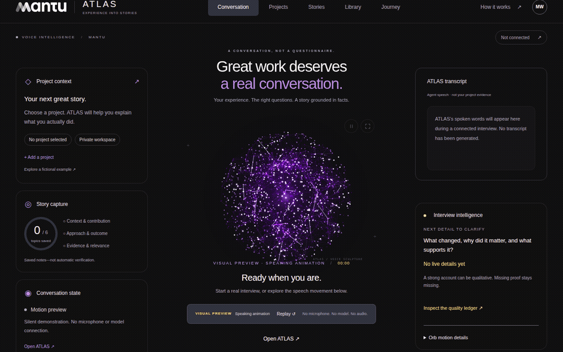
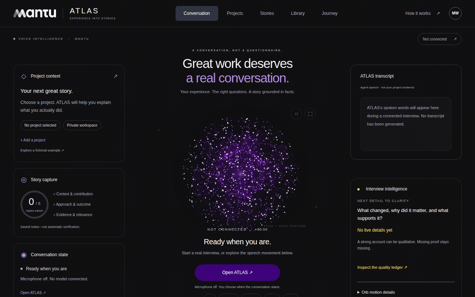
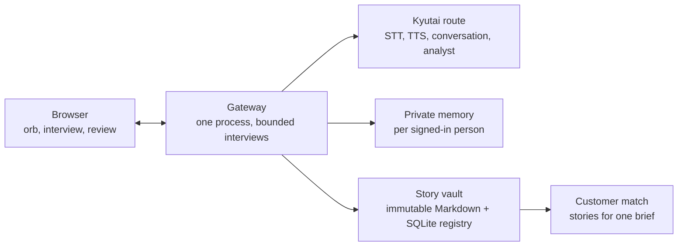
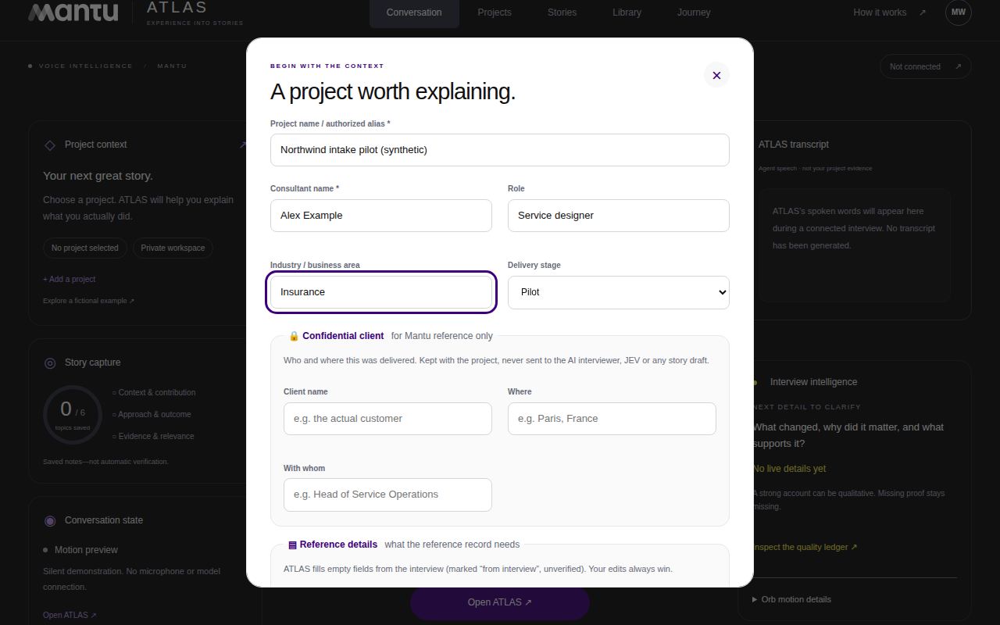
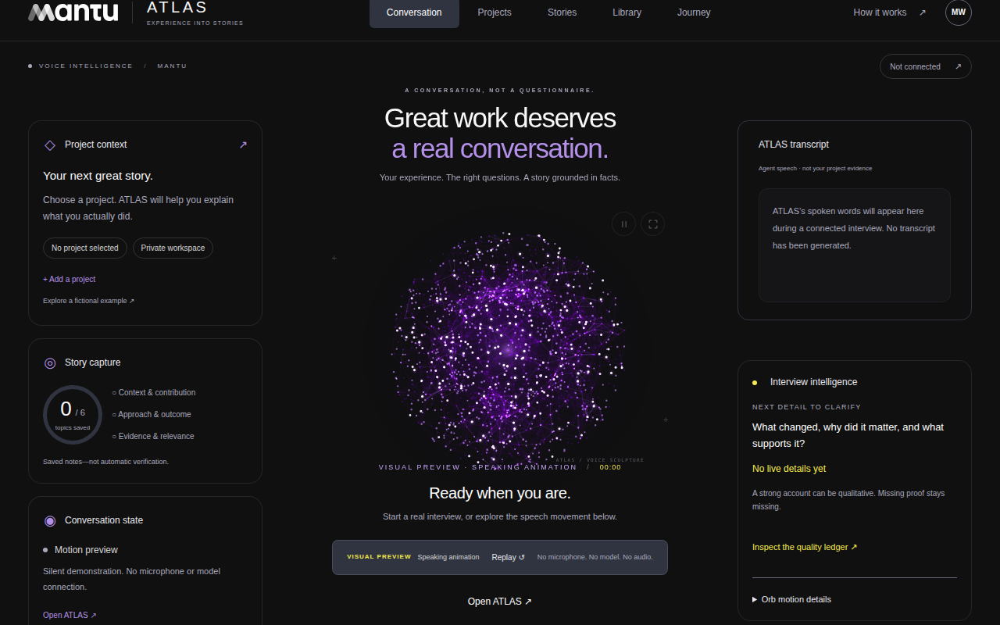

# Atlas

**A voice-first interviewer that turns one consultant's real work into a reviewable project story.**

The conversation is the product. The orb is the interface. Atlas asks one useful question at a time, keeps uncertainty visible, and writes a story you can review before anyone treats it as evidence.



## What Atlas does

A consultant talks about a piece of work. Atlas listens, accepts a correction, and asks for the concrete example that is still missing: what happened, who was affected, what the consultant personally owned, what was rejected, who adopted the change, and what was actually observed. "40% better" stays an unverified claim until the metric, the before and after, the units, the period, and the source are all present.

From that conversation Atlas keeps:

- a quote-linked evidence record, with unknown and confidential left open
- an immutable Markdown story, revised rather than overwritten
- a customer brief match that ranks eligible stories, never people, and can return no strong match

Private memory helps the next conversation with the same person. It is not evidence and it does not become a customer claim on its own.



## How it works

The browser is one self-contained page: the interview, the particle orb, and the review tools. `build.py` writes four identical HTML files. No frontend framework and no CDN.

The gateway is one process. It caps concurrent interviews and keeps one active interview per signed-in person. The selected voice route is Kyutai speech-to-text and text-to-speech, plus a conversation model and an evidence analyst. OpenAI Realtime and NVIDIA PersonaPlex remain explicit alternatives. Atlas does not switch provider on its own.



The orb moves from output audio that was actually played. A timer, a tool call, or a block of agent text does not pretend to be speech. The buttons under the orb are a silent preview.

## Quickstart

Synthetic data only. Nothing below calls a paid provider.

```sh
python3 build.py
python3 scripts/preview.py
```

Open `http://127.0.0.1:8000`. The preview serves the compiled page and refuses anything else. Choose **Add a project** and use a fictional record, for example:

| Field | Value |
|---|---|
| Project name | Northwind intake pilot (synthetic) |
| Consultant | Alex Example |
| Role | Service designer |
| Industry | Insurance |
| Delivery stage | Pilot |



The home screen, with the speaking preview and the microphone still off:



A real conversation needs the gateway, a voice provider, and server-side credentials in an uncommitted `.env` copied from `.env.example`. The preview above does not use those credentials. Operator setup for the gateway, identity, and the story vault lives in [00_START_HERE.md](00_START_HERE.md).

## Security model

- Provider credentials stay on the server. They are not written into the HTML, the browser, or a URL.
- The signed-in person does not choose someone else's memory bank. The server derives it from the authenticated identity.
- Private memory is continuity for the next interview. It is not a source for a customer claim.
- A story is an immutable Markdown revision. A SQLite registry controls the current version, access, review, expiry, and withdrawal. Authors do not approve their own facts.
- The interview agent cannot approve, publish, grant access, or write private memory.
- Customer matching ranks stories for one brief. A weak or poorly evidenced story can produce no strong match. The score is not a performance rating.
- An unknown answer and a confidential answer both stay open. After two unproductive probes on the same point, Atlas offers to move on.

See [SECURITY.md](SECURITY.md) to report a vulnerability.

## Contributing

Use fictional projects and fictional people in issues, tests, and screenshots. Do not commit `.env`, a vault, a key, or a customer export. `.env.example` is the only environment file that belongs in git.

```sh
python3 build.py
node --test tests/*.test.js
python3 -m pytest tests/test_*.py -q
gitleaks detect --no-git --config .gitleaks.toml --redact
```

`tests/test_oss_readiness.py` checks that `LICENSE` exists, that every `docs/media` link in this README is a file under 3 MB, and that gitleaks on the working tree reports nothing. The gitleaks binary has to be on `PATH`. The test does not scan git history.

Browser suites are `make test-ui`. They are local and offline.

## License

Source code and documentation are [MIT](LICENSE), copyright Tony WALTEUR.

The name Mantu and `assets/Mantu.svg` are brand assets and are not covered by that grant. Third-party notices are in [docs/THIRD_PARTY.md](docs/THIRD_PARTY.md).
