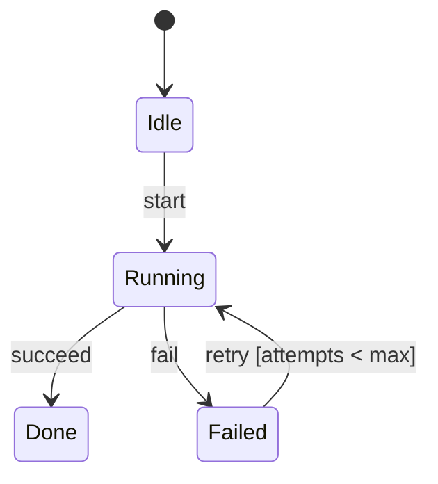

<!-- Vendored verbatim; source sha256 c62dff48dc032e70df170c3161709ae7bfb79f1e25db473b730a300cedb82f0c -->
# Implicit state machine standard (portfolio-wide, owner: Devin, v1 2026-11-11)

## 1. What counts as an implicit state machine (flag it if 2+ hold)
- Several booleans that describe one lifecycle (isLoading/isDone/hasError/isRetrying) and can combine into impossible pairs.
- A string/enum `status` field mutated from more than one place with no central rule for which change is allowed.
- Nested if/else or switch on "where we are" spread over handlers, effects, IPC/route handlers or timers.
- Ordering assumptions: "X must run after Y", re-entrancy guards, `if (alreadyStarted) return`.
- Retry/backoff/cancel/timeout logic, onboarding/wizard steps, connection or auth lifecycles, job/queue/batch pipelines, window/overlay modes, sync/import/export/upload flows, payment or approval flows.
- Persisted status in DB/files/settings that the code later "heals" or migrates.
Not one: a single boolean toggle with no ordering rules; a pure data mapping; UI-only open/closed with no side effects.

## 2. Shape of a fix
1. Typed states: one discriminated union/enum; per-state data lives on the state (no orphan fields). Impossible combinations become unrepresentable.
2. Typed events: every input that can change state is a named event.
3. One transition function (reducer or table) `transition(state, event) -> state | IllegalTransition`, pure, no I/O. Side effects run from the result (effects list or effect runner), never inside the reducer.
4. Guards: explicit, named, tested. Illegal transitions are rejected and logged (never silently ignored, never throw past the boundary unless that's the documented contract).
5. Single writer: only the machine changes status. Grep should find no other assignment to the old flags.
6. Persistence: persisted state is versioned; loading an unknown/legacy value maps to a defined safe state (and is not rewritten unless the migration says so).
7. Platform/feature branches (OS, flags) are inputs to guards, not hidden forks in handlers (see Métis G8-F1: a Linux path with no reveal transition).
8. Smallest change that removes the implicitness. No new framework/dependency (XState etc.) unless the owner justifies it in the doc; a plain reducer + table is the default.

## 3. Tests (required in the same PR)
- Table-driven test of every legal transition.
- Every illegal (state, event) pair is rejected: generate the full cross product, assert rejection for pairs not in the table.
- Each guard: allow and deny case.
- Persistence: legacy/unknown stored value -> safe state; round-trip.
- At least one regression test for the bug that motivated the change, if any.
- Behaviour-preserving: existing tests stay green without edits, or each edit is justified in the PR.

## 4. Inventory (per project, before coding)
One row per candidate: location (file:line), what lifecycle it is, flags/fields involved, known bugs it caused, risk (H/M/L), decision (FIX now / LATER / NOT A MACHINE, with reason). Fix H first. Over-engineering check: if a candidate has 2 states and no ordering rules, mark NOT A MACHINE.

## 5. Delivery (senior-engineering-delivery-workflow)
Isolated branch per project (e.g. `cursor/state-machines-<project>`), small commits (one machine per commit), ordinary push only: no force, no hook bypass, never main. Writers on Grok 4.7 or Composer 2.5 only. Independent QA by a non-writer, exact-head CI, merge/deploy only with Tony's authority. Send the inventory to Devin for review before coding H items.

---
# docs/state-machines.md template (copy into each repo)

```markdown
# State machines in <project>
Last reviewed: <date> at <commit>

## Inventory
| # | Machine | Location | Status | Risk | Notes |
|---|---|---|---|---|---|
| 1 | <name> | src/... | FIXED / LATER / NOT A MACHINE | H/M/L | <reason> |

## <Machine name>
- Purpose: <one sentence>
- Code: <file of reducer/table>, tests: <file>
- Persisted: <yes/no, where, version, legacy mapping>

### States
| State | Data carried | Meaning |
|---|---|---|

### Events
| Event | Source (UI/IPC/timer/network) |
|---|---|

### Transitions
| From | Event | Guard | To | Side effects |
|---|---|---|---|---|

Anything not in this table is illegal and is rejected and logged.



### Platform / flag differences
<per-OS or per-flag guard differences, or "none">
```
