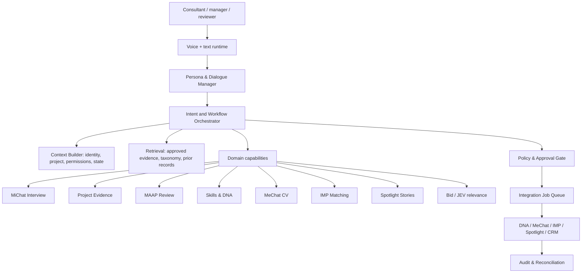

# Atlas Cognitive Architecture — The Brain Behind the Agent

## 1. Design principle
One coherent persona; multiple bounded capabilities. The conversational layer does not own every business rule or write to every system. It coordinates domain workflows and tools under deterministic policy.

## 2. Logical architecture

## 3. Cognitive components
### A. Persona and dialogue manager
Owns tone, turn-taking, pacing, open-question behaviour, empathy and conversational repair. It is stable across workflows; domain vocabulary is loaded contextually.

### B. Intent and workflow router
Classifies purpose: capture experience, update project evidence, prepare MAAP, review/approve evidence, generate CV, explore staffing, draft success story, find bid proof, correct/withdraw content, or ask general questions. It should ask a clarifying question when two workflows have materially different permissions or consequences.

### C. Context builder
Builds a minimal, permission-filtered context bundle:
- authenticated user and role
- stable consultant/project/opportunity IDs
- active workflow and state
- relevant source records and their freshness
- user language and requested output language
- permission grants and data classification
- outstanding questions, evidence gaps and prior turn summary
It must not retrieve broad private history merely because it is available.

### D. Retrieval and memory
Use a tiered model:
1. **Session state:** active interview/review/story, ephemeral and recoverable.
2. **User continuity memory:** preferences such as preferred language or interaction style, only where permitted and useful.
3. **Evidence store:** versioned organizational records with source links and approvals.
4. **Reference knowledge:** taxonomies, templates, policy, question banks and playbooks.
5. **Derived knowledge graph:** links between people, projects, skills, artifacts, stories and opportunities.

If Hindsight is used for personal continuity, it must not become the evidence source of truth. Memory is a convenience layer; authoritative evidence remains versioned and auditable. No cross-user memory leakage.

### E. Domain specialists
- Interview specialist: adaptive questioning and coverage.
- Evidence specialist: claim extraction, provenance and contradiction detection.
- MAAP specialist: configured review forms and actions.
- Skills specialist: taxonomy mapping and assessment routing.
- CV specialist: approved-claim selection and tailoring.
- Matching specialist: explainable fit and gap analysis.
- Story specialist: narrative drafting from approved evidence.
- Governance specialist: permissions, approvals, retention and audit.

Specialists return structured proposals and rationale. They cannot bypass the policy gate.

### F. Policy and approval gate
Deterministic enforcement for role access, project scope, required approvals, allowed state transitions, destination permission, version checks, and write eligibility. The model may explain a policy but cannot waive it.

### G. Integration orchestrator
Uses durable jobs, idempotency keys, retries, backoff, per-destination status, acknowledgements, reconciliation and manual recovery. Partial success must be visible.

## 4. Decision loop
1. Understand user intent.
2. Resolve identity and active workflow.
3. Retrieve only authorized, relevant context.
4. Determine the next best question or action.
5. If conversational: ask one open question, listen, interpret and update session state.
6. If factual: create claims with provenance and uncertainty.
7. If consequential: prepare a change proposal and route for approval.
8. If approved: execute through the integration queue.
9. Verify destination acknowledgement.
10. Tell the user what happened, what remains and who owns the next step.

## 5. Question selection brain
At every turn, rank candidate questions by:
- importance to the workflow objective
- information gain
- whether the answer is already known
- whether it resolves a material ambiguity
- user effort and conversational fatigue
- sensitivity and permission
- whether a human reviewer can resolve it more appropriately

Choose the single highest-value, least burdensome question. Do not maximise question count.

## 6. Conversation state
Suggested states: greeting → purpose/consent → context discovery → contribution discovery → evidence probing → outcome probing → skill mapping → summary → user correction → submission → reviewer queue → approved/returned/closed. User may pause, resume, skip a question or withdraw where policy permits.

## 7. Agent autonomy levels
- **Level 0 — Explain:** answer questions, no data changes.
- **Level 1 — Draft:** create proposed interview summaries, evidence records or stories.
- **Level 2 — Prepare:** prefill review forms and destination payloads, no external write.
- **Level 3 — Governed write:** perform approved internal synchronization with explicit scope and audit.
- **Level 4 — Publish/externally consequential:** requires explicit approval of exact revision and permissions. Never autonomous by default.

## 8. Failure and recovery
If the user disconnects, save a recoverable checkpoint and resume from the last confirmed answer. If ASR confidence is low, ask for confirmation instead of guessing. If sources conflict, show the conflict and request adjudication. If a destination is unavailable, preserve the approved payload and report pending status. If permissions are unclear, do not retrieve or write.
