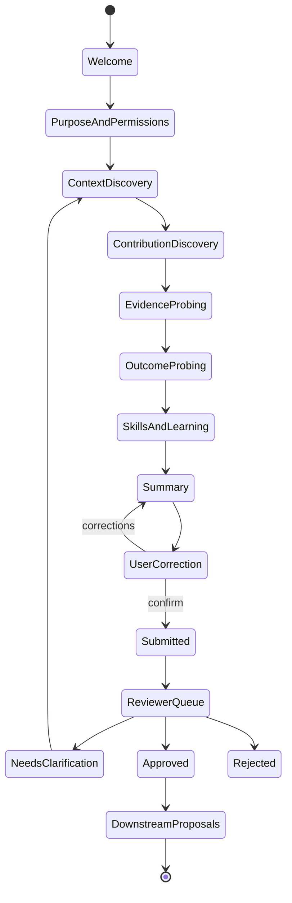

# Atlas Conversation State Machine

States:
- `welcome`: introduce Atlas and purpose.
- `purpose_permissions`: explain data use and capture scope.
- `context_discovery`: identify project and starting context.
- `contribution_discovery`: role, ownership and action.
- `evidence_probing`: sources, artifacts, metrics and attribution.
- `outcome_probing`: impact and measurement.
- `skills_learning`: capabilities and lessons.
- `summary`: compose human-readable recap.
- `user_correction`: edit, skip, anonymise or withdraw where allowed.
- `submitted`: freeze submitted revision for review.
- `reviewer_queue`: accountable human review.
- `needs_clarification`: return targeted questions.
- `approved/rejected`: explicit reviewer decision.
- `downstream_proposals`: create purpose-specific integration proposals.

Every state transition records actor, timestamp, workflow version and reason. Pause/resume restores state without repeating confirmed questions. A user can ask to stop or skip at any point; missing fields remain explicitly incomplete.
