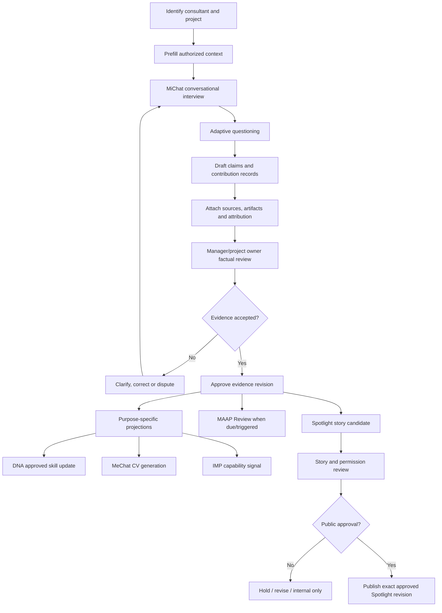

# Atlas End-to-End Workflows

## 1. Main lifecycle

## 2. Capture workflow
1. Resolve identity and project scope.
2. Explain purpose and intended use.
3. Prefill only authorized information.
4. Conduct adaptive conversation.
5. Convert answer spans into atomic claims with attribution.
6. Link available artifacts and source references.
7. Show user a readable summary.
8. User corrects and submits.
9. Route to accountable reviewer.
10. Save a versioned record and audit event.

## 3. Evidence review workflow
Reviewer sees claim, source, attribution, confidence as a model aid only, status, prior revision and downstream impact. Actions: approve, amend, request clarification, dispute, reject or withdraw. Any amendment creates a new revision. Approval applies to the exact revision reviewed.

## 4. Downstream workflow fan-out
Once evidence is approved, create independent proposals:
- DNA: skill/profile changes.
- MeChat: CV-ready experience.
- IMP: evidence-backed capability signal.
- MAAP: contextual evidence for review.
- Spotlight: story candidate.
- Bid/JEV: relevant proof retrieval.

Each output has its own permission check, validation and destination status. Do not treat one approval as a blanket approval.

## 5. Manager and reviewer workflow
Queue → open dossier → inspect source and attribution → review gaps → request clarification or decide → record rationale → approve/return → monitor follow-up. Manager decisions are attributable and versioned.

## 6. Error states
- Incomplete interview: resume from checkpoint.
- Unclear transcription: ask user to confirm.
- Conflicting sources: preserve both and route for adjudication.
- Reviewer rejection: return with actionable reason.
- Permission withdrawn: suspend affected downstream use and evaluate derivatives.
- Destination unavailable: keep approved payload pending; do not claim sync success.
- Duplicate event: idempotency prevents duplicate records.
- Concurrent edit: detect revision conflict; do not silently overwrite.
