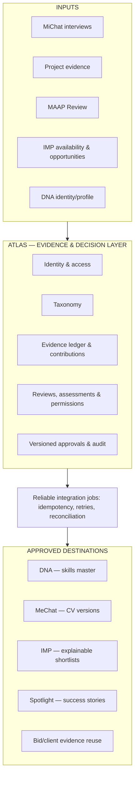
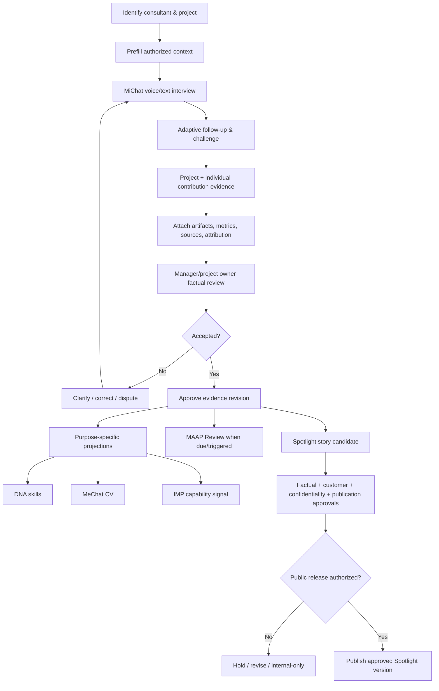

# ATLAS — Project Intelligence Platform
## Product & workflow blueprint | v1.0 | 30 October 2026

**Promise: Capture once. Validate with accountable humans. Reuse safely many times.**

**Terminology:** MiChat is the consultant experience-capture workflow in this document. Earlier architecture describes MeChat as the downstream CV destination. Confirm whether they are distinct or one is a rename. **Spotlight** is the success-story publication destination. Replace generic “Publication” with “Spotlight — Success Stories”. MAAP is a first-class review capability; its official expansion and rubric require process-owner confirmation.

# 1. Executive summary
Atlas is Mantu’s **Project Intelligence and Evidence Platform**: the shared evidence, review and decision layer connecting consultant experience, project delivery, people development, staffing and commercial storytelling. It does not replace DNA, MiChat/MeChat, IMP, CRM, finance or the corporate CMS. It creates trusted, permission-aware records and sends approved projections to systems that own operational data.

Six capabilities: **MiChat** (experience capture); **Project Intelligence** (project/contribution evidence); **MAAP Review** (structured review/actions); **Skills & DNA** (verified skills); **IMP Intelligence** (availability-aware matching); **Spotlight** (success-story publication/reuse).

# 2. Principles and system boundaries
- Evidence before assertion; material claims link to a source, artifact, contributor or reviewer.
- AI extracts, asks, classifies and drafts; authorized humans approve.
- Separate factual validation, skill proficiency, credential validity, MAAP outcome, staffing eligibility and publication permission.
- Missing evidence means unknown/unverified, not “no skill” or “poor performance”.
- Corrections create revisions, not silent overwrites. Apply least privilege by identity, project, role, country and purpose.
- Internal reuse permission does not automatically permit CV, bid, client-facing or public use.
- Design globally with country-specific policy. Automation reduces administration, not human management relationships.

| Domain | Atlas role | System of record / destination |
|---|---|---|
| Identity | Map stable cross-system IDs | DNA / workforce identity |
| Project evidence | Capture contribution, artifacts, outcomes | Project/account source (confirm) |
| Skills | Propose evidence-backed changes | DNA owns approved skills |
| CV | Supply approved experience | MeChat renders CV versions |
| Availability | Consume availability/freshness | IMP |
| Demand | Consume role requirements/status | Opportunity / CRM |
| Success stories | Draft, validate, permission-check | Spotlight / CMS |

# 3. Target architecture

**Proposed contracts are not live integrations.** Prior source review found interview/evidence capture, reference-library review/audit states, DNA inbound prefill and bid proof matching. It did not establish live DNA skills writeback, MeChat or IMP adapters, availability matching or public CMS publication.

# 4. End-to-end workflow

Stages: identify stable IDs/access → capture in MiChat → structure claims/contributions → validate facts → run MAAP when scheduled/triggered → create destination-specific projections → publish only after separate Spotlight authorization → reuse approved evidence in bids/client conversations.

**MAAP completion does not authorize Spotlight publication. DNA approval does not imply CV inclusion. CV inclusion does not imply public permission.**

# 5. MiChat — consultant experience capture
Conversational entry point for real experience. Support voice/text, save/resume, correction and summary review. Interview topics: project context/business problem; individual role; personal contribution; methods/tools/technologies; deliverables/artifacts; outcomes/metrics; skills demonstrated; lessons/reuse.

AI rules: ask one question at a time; challenge vague “improved/optimised/led/automated” claims; distinguish personal contribution from team outcomes; ask for baseline, after-state, unit, period and source; distinguish measured result, estimate, anecdote and unverified claim; detect contradictions; allow “unknown/cannot disclose”; never invent metrics, client names or credentials.

# 6. Project Intelligence — evidence model
**Project:** stable ID; account/client; country/practice; dates; lifecycle (proposed, won-not-started, active, completed, cancelled, unknown); scope/objectives; owner; stakeholders; artifacts; outcomes; risks; deviations; lessons; validation history.

**Contribution:** consultant/project IDs; role/dates; responsibilities; personally owned actions; deliverables; artifacts; linked skills; outcome contribution; attribution confidence; reviewer/revision.

States: Draft → Needs clarification → Submitted → Validated; exception states: Disputed, Rejected, Superseded, Withdrawn. Corrections create revisions. Metrics need value, unit, baseline, after-state, period, source and attribution. Qualitative outcomes remain valid. Won-but-not-started work is not delivered experience.

# 7. MAAP Review — dedicated capability
Purpose: structured, traceable review and follow-up connected to Atlas evidence, but separate from factual evidence validation.

**To confirm:** official MAAP expansion, purpose, rubric, rating model, cadence, participants, required fields, country variations and retention policy were not supplied. This document defines a workflow shell; the process owner must provide official rules. Do not invent a score scale.

Proposed sections: (1) metadata: consultant, project, period, country, review type, due date, reviewer/participants; (2) consultant perspective: assignment experience, role clarity, workload, support, blockers, feedback; (3) project context: scope, status, quality, collaboration, customer feedback, risks; (4) contribution/achievements with evidence; (5) skills/development, gaps, training/certifications; (6) risks/support within approved policy; (7) actions with owner, due date, priority, status, escalation; (8) conclusion, manager comments, acknowledgement, disagreement and next checkpoint.

Workflow: trigger → prepare context → collect inputs → manager/consultant discussion → resolve factual gaps while preserving differing perspectives → authorized reviewer records outcome → assign actions → acknowledge/close → reuse only approved facts.

Controls: acknowledgement means seen, not agreement; closed reviews require audited amendments; disagreement is preserved; no automated employment/compensation/promotion/termination decisions; no sentiment inference from voice tone; sensitive people information requires explicit access, retention and purpose rules.

# 8. Skills & DNA
Use shared taxonomy with stable IDs/versioning. Link each skill assertion to contribution/evidence. Keep self-declared, evidence-supported, assessed and credential-verified statuses distinct. Track last used, assessed, credential-verified and synchronized separately. DNA remains skills master. Atlas sends approved, versioned changes; retries cannot duplicate; concurrent edits surface conflicts. Story quality is never a skill score.

# 9. MeChat — CV destination
Earlier architecture describes MeChat as CV renderer. Atlas supplies approved profile revisions, not raw transcripts. Contract: consultant ID; approved profile revision; contribution records/source references; language; audience/target role; template; confidentiality permissions. MeChat returns document/version ID and status.

CV rules: claims are supported; tailoring changes emphasis, not facts; won-not-started work is not delivery experience; confidential names are suppressed/anonymised; evidence corrections identify affected CV versions. Confirm whether MiChat and MeChat are distinct products or a rename before final API naming.

# 10. IMP Intelligence
IMP is authoritative for availability/IC context, subject to confirmation. Opportunity system supplies demand; Atlas supplies evidence-backed capability signals. Retrieve requirements → verified skills → current IMP availability/constraints → deterministic mandatory eligibility → preferred-skill/evidence ranking → explain gaps/freshness → staffing owner decides.

Do not fabricate availability or IC definitions. Interview recap describes IC/TLO in Brazil, but official definitions must be confirmed country by country. Missing data remains visible.

# 11. Spotlight — Success Stories and publication
Spotlight is the success-story publication/distribution destination. Rename “Publication” in the diagram to **Spotlight — Success Stories**.

Story: customer context; challenge; scope/starting point; consultant/team contribution; approach; technologies; deliverables; measured or qualitative outcomes; evidence; lessons; reuse relevance; approved call to action.

Workflow: select candidate by evidence/relevance/permission → draft from approved source revision → validate each claim → obtain project/account and customer approval where required → review confidentiality/privacy/legal/brand → confirm client naming and metric permissions independently → authorize specific public version → publish and record CMS ID, URL, revision, approvers/date → track distribution and inquiries.

Permissions are separate: internal reuse; CV use; bid/client-facing use; external/public publication. A validated fact is not automatically publishable. Corrections/withdrawals identify derivative assets and trigger review/update/takedown. Distinguish sourced inquiries and influenced pipeline from causal revenue impact.

# 12. Governance and audit
Map workforce identity to immutable consultant IDs; email is not a stable key. Enforce role/purpose access and project scope. Preserve source, claim, author, timestamp, reviewer, status, revision and relationships. Keep private interview continuity separate from validated evidence and public content. Integration jobs record source revision, destination, payload hash, attempts, acknowledgement, error and reconciliation state. Retries are idempotent; partial success is tracked per destination. Apply minimization, retention, access logging, withdrawal handling and country-specific rules.

# 13. Core entities and integration contracts
Entities: Consultant; Project; Contribution; EvidenceItem; OutcomeClaim; SkillTaxonomyItem; SkillAssertion; Assessment; Credential; MAAPReview; ReviewParticipant; ReviewAction; Story; StoryRevision; PermissionGrant; ProfileRevision; IntegrationJob; AuditEvent; OpportunityReference.

Contracts: **DNA** receives approved skill assertions, evidence refs, revision, reviewer and effective date. **MeChat** receives approved profile revision, language, audience, template, source claims and permissions; returns document/version ID. **IMP** supplies availability window, allocation, constraints and freshness. **Opportunity system** supplies requirements, mandatory/preferred criteria, location/time-zone and lifecycle. **Spotlight** receives approved public story revision, client naming/metric permissions and CTA; returns CMS ID/URL/status.

Reliability: idempotency key per source revision/destination; version checks; bounded retry/backoff; partial-success handling; manual recovery; reconciliation dashboard; no green status until destination acknowledges. If DNA succeeds and MeChat times out, retry only MeChat.

# 14. Acceptance criteria
- MiChat supports voice/text, save/resume and correction; challenges unsupported claims; AI cannot approve.
- Evidence links outcomes to sources; project and individual contributions are separate; corrections create revisions.
- MAAP uses process-owner-approved rubric; acknowledgement differs from agreement; amendments are audited; actions are tracked.
- DNA uses stable IDs; retries do not duplicate; concurrent edits surface conflicts; unverified claims do not write back.
- MeChat claims map to approved revisions; tailoring preserves facts; confidential names are suppressed.
- IMP shortlists explain evidence/gaps; mandatory rules are deterministic; stale/missing availability is visible.
- Spotlight requires explicit public authorization; every public claim maps to approved evidence; naming/metric permissions are separate; withdrawal identifies derivatives.

# 15. Delivery sequence and measures
**Phase 0:** confirm identity keys, system owners, MAAP rules, taxonomy, data classification, permissions and APIs. **Phase 1:** MiChat, project/contribution evidence, source links, review and audit. **Phase 2:** MAAP templates, triggers, participants, actions and closure. **Phase 3:** DNA and MeChat. **Phase 4:** IMP availability and explainable matching. **Phase 5:** Spotlight approvals, CMS publishing and attribution.

Pilot: one consultant, one completed project and one live opportunity. Capture once; approve DNA change; generate MeChat CV; combine evidence with IMP availability; produce explained shortlist; publish Spotlight only with separate permission.

Measures: evidence-backed project coverage; profile freshness; MAAP completion/action closure; manager correction rate; CV turnaround; DNA sync success; shortlist acceptance; time-to-staff; Spotlight approvals/publications; qualified inquiries and attributed opportunities. Establish baselines before ROI claims.

# 16. Decisions to close
1. Are MiChat and MeChat distinct or one rename?
2. What does MAAP officially stand for? Who owns rubric, cadence, participants and country variants?
3. Who owns Spotlight CMS/API, publication approvals, locales and lead routing?
4. What are DNA IDs, taxonomy, write API, concurrency rules and acknowledgement schema?
5. What are MeChat API, templates, language/audience parameters and async status?
6. What are IMP availability fields, IC/TLO definitions, refresh cadence and time-zone rules?
7. Which opportunity system is authoritative?
8. Who can validate facts, approve skills, close MAAP, authorize CV use, approve customer naming and grant public permission?
9. What country-specific privacy, retention, deletion and legal rules apply?

# Appendix — source discipline
Based on the Atlas architecture review dated 21 October 2026 (repository review pinned to commit efb4948 dated 2 October), the delivery interview recap supplied 30 October, the supplied architecture diagram, and the requested MiChat/MAAP/Spotlight corrections. Existing implementation, interview-derived opportunities, proposed behaviour and unresolved decisions must remain distinct. No live API or production integration is asserted without an acknowledged round trip.
