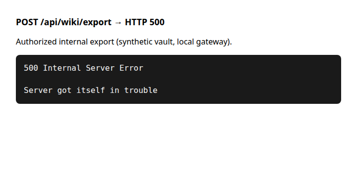
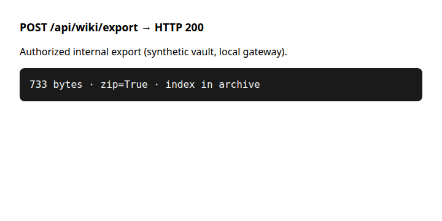
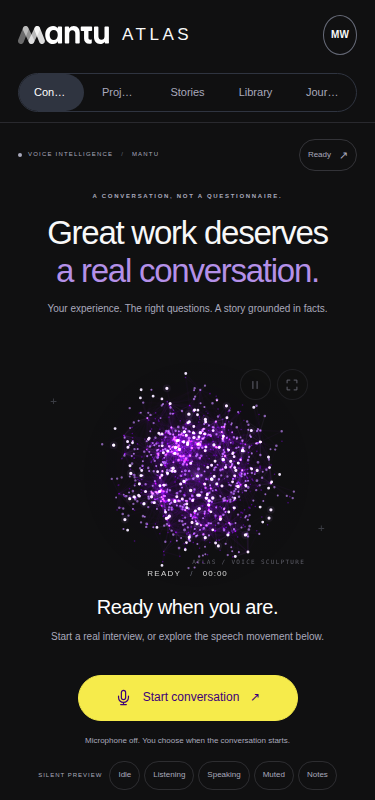
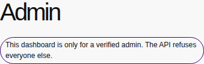

# Authorized wiki export and `/#admin` deep links work on a merged main

**Draft** · base `c14302590e78b0319baab5893ef8c378b1c0bdf1` · evidence at merge + manifest on this branch

## Why it matters

Consultants need authorized wiki ZIP bytes they can open, not an opaque 500 from the gateway. Bookmarks to `/#admin` must show the same verified-admin refusal as the nav, not a blank shell. After PR9, release checks must include a full source-only HTML rebuild and an accurate `MANIFEST.json`.

## What changed

- **M-1:** CSP boundary classifies from `content_type`; HTML bodies only touch `response.text` so ZIP is never UTF-8-decoded.
- **M-3:** `openFromHash` handles `#admin` via `switchView('admin')`; existing `renderAdmin()` denial copy unchanged.
- **M-2:** **Withdrawn** — measured on `main` `c143025` at 320 / 375 / 1280, `#journey` has no horizontal overflow with synthetic fixtures; PR9 layout stands. See `handoff/decisions/M-2-journey-layout.md`.
- **MANIFEST / check_handoff:** 692 tracked files; dev tree uses `git ls-files` for unlisted; clean rebuild copies `atlas_voice/` and `deploy/cloudflare-edge/`.
- **ask_browser:** deterministic Playwright waits (prior commit on branch).

Screenshots (synthetic, hosted on **`pr-assets`** only — not on this branch):

| | Before (`c143025`) | After (this branch) |
|---|---|---|
| M-1 wiki export HTTP |  |  |
| M-3 `/#admin` consultant |  |  |

---

## Done when

- [ ] **t10-M-1** — Authorized wiki export returns HTTP **200** and a valid ZIP (no CSP UTF-8 decode on binary).
- [ ] **t10-M-3** — Consultant `/#admin` shows the verified-admin refusal (no blank admin shell).
- [ ] **t10-MANIFEST** — `manifest-content` passes for **692** git-tracked release files.
- [ ] **t10-check_handoff** — `python3 scripts/check_handoff.py .` passes including **clean-build** and **clean-build-byte-match**.
- [ ] **t10-ask_browser** — `python3 tests/ask_browser.py` stable without fixed sleeps (regression on branch).

---

## Verification map

| Ticket | Risk | Failing test | TEST COMMAND | Red | Fix |
|--------|------|--------------|--------------|-----|-----|
| **t10-M-1** | medium (binary response / CSP) | `tests/test_quality.py::test_wiki_export_http_roundtrip_returns_zip` | `python3 -m pytest tests/test_quality.py::test_wiki_export_http_roundtrip_returns_zip -q` | `346b036` | `9d8a616` |
| **t10-M-3** | low (deep link UX; access unchanged) | `tests/admin_metrics_browser.py` → `consultant #admin deep link shows the refusal state` | `python3 tests/admin_metrics_browser.py` | `76b02eb` | `a9878d6` |
| **t10-MANIFEST** | low (release integrity) | `check_handoff` → `manifest-content` | `python3 scripts/check_handoff.py . --no-rebuild` | drift at `02a83b32` / post-merge | `18f5d5e`, `bb14e2e` manifest |
| **t10-check_handoff** | low | `tests/test_handoff.py::test_repository_full_handoff_includes_clean_rebuild` | `python3 -m pytest tests/test_handoff.py::test_repository_full_handoff_includes_clean_rebuild -q` and `python3 scripts/check_handoff.py .` | `dfc4636` (rebuild staging) | `76536e4`, `bb14e2e` |
| **t10-ask_browser** | low (flake) | `tests/ask_browser.py` | `python3 tests/ask_browser.py` | prior fixed sleeps | `bd95020` |

**M-2:** withdrawn — no ticket row. Measurement: `python3 scripts/measure_journey_overflow.py /path/to/main/checkout` → all `#journey` rows `overflow=False` at 320 / 375 / 1280 on `c143025`.

---

## Unslop (UI)

| Area | Before | After | Kept |
|------|--------|-------|------|
| Wiki export (M-1) | Server returned 500; no user-safe ZIP | HTTP 200 + zip; no new UI strings | Existing intelligence/wiki actions |
| `/#admin` (M-3) | Deep link: timeout / blank shell | Same refusal banner as nav click | `handoff/decisions/post-pr9-unslop.md` — no invented copy |

---

## Decision record

| Item | Chosen | Rejected | Why |
|------|--------|----------|-----|
| M-1 | `content_type` gate before reading body | Always read `response.text` | ZIP is not UTF-8 |
| M-3 | `switchView('admin')` | New refusal copy | Existing denial UI |
| M-2 | Withdraw; `journey.css` = `main` `c143025` | 960px rule + `journey_layout_browser.py` | Test never red on main; identical measures |
| check_handoff | Copy `atlas_voice/` + edge paths; git index unlisted | Filesystem walk on dev tree | Rebuild + gitignored artifacts |
| Top bar 600px | **Out of scope** (Backlog) | Fold into PR10 | Pre-existing on main (615–671 px); not journey panel |

Logs: `handoff/decisions/M-1-wiki-export-csp.md`, `M-2-journey-layout.md`, `M-3-admin-hash.md`, `check-handoff-rebuild.md`.

---

## Rollback

Revert this branch to **`c14302590e78b0319baab5893ef8c378b1c0bdf1`** (`origin/main` after PR9). On `main`, wiki export and consultant `/#admin` deep link regress to pre-PR10 behavior; manifest/rebuild fixes from this PR are not on `main` until merged.

---

## Verified by

```sh
python3 build.py
node --test tests/*.test.js
python3 -m pytest tests/test_*.py -q
cd deploy/cloudflare-edge && ATLAS_WORKERD_ROOT=/tmp/atlas-workerd-20261023 node --test test/*.test.js
make test-ui   # ×3 on release gate
python3 scripts/check_handoff.py .
```

Non-author exact-head review (Devin loop 2+, Cursor, Inspector): **pending** after next push.