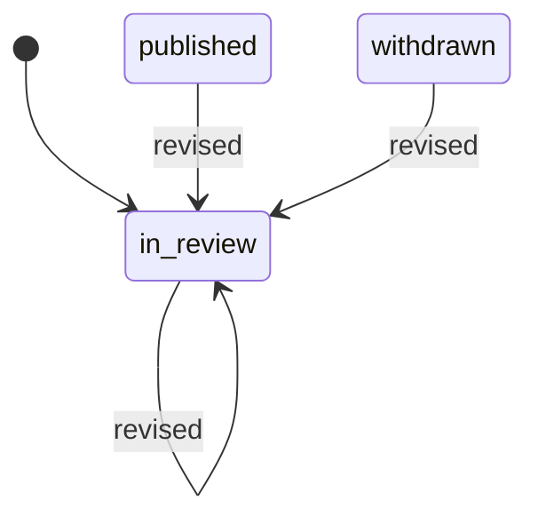
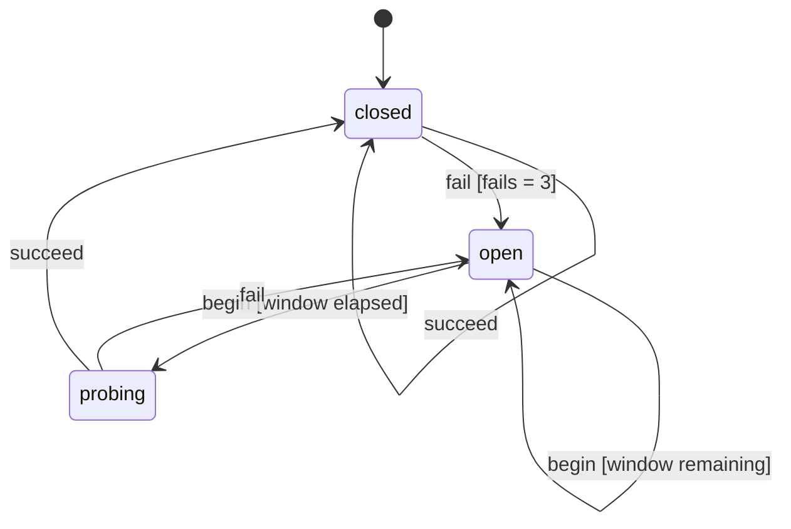
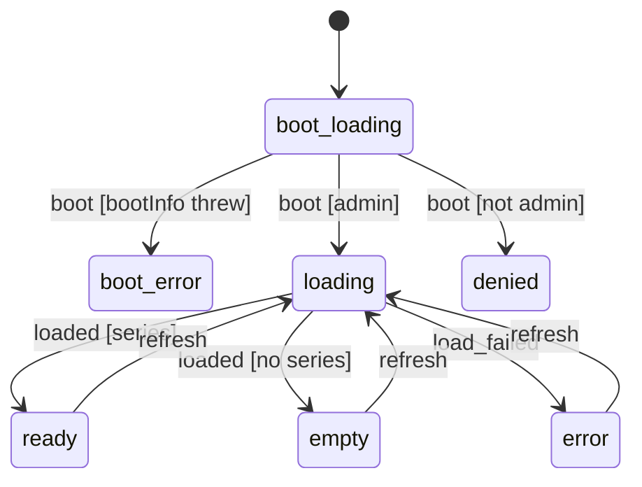

# State machines in ATLAS
Last reviewed: 2026-11-11 on `cursor/state-machines-atlas-v2` at `8d17dd10a577489507502c16cf472b3d59ba093d`. This stamp is that code commit, because this docs commit cannot name itself.

The rules are `docs/STATE-MACHINE-STANDARD.md`. This file keeps the ATLAS inventory and does not restate them. Row 9, story publication, is fixed in this branch. The other high-risk rows are still pending review.

## Inventory

Row shape: section 4 of `docs/STATE-MACHINE-STANDARD.md`. Status in the summary table is the decision; it becomes FIXED only in the commit that lands that machine.

| # | Machine | Location | Lifecycle | Flags / fields | Known bugs | Risk | Decision |
|---|---|---|---|---|---|---|---|
| 1 | Edge interview session | `deploy/cloudflare-edge/src/session.js:126` (flags at :145, hold writes at :228, :272, :437, :448, :610) | One live interview: turn-taking, continuation hold, barge-in, playback, end | `hold`, `listening`, `continuing`, `echoable`, `acked`, `playbackDone`, `loudRun`, `gen`, queue | Run65 session 8 turn 2 was fixed in run66–run68. No new bug filed here. A wrong guard drops or doubles speech. | H | LATER. Pending review. The session is the voice product; a reducer rewrite can change what is heard. |
| 2 | Edge interview ledger | `deploy/cloudflare-edge/src/ledger.js:15` | Which story field is open, recorded, or deferred during the interview | detail `status` strings, `next_field`, probe budget | None newly reproduced. | H | LATER. Pending review. It decides the next question. |
| 3 | Python interview run | `atlas_voice/cascade.py:162` | Connect, speak, cancel, discard, end for the Kyutai/Workers cascade | task cancellation, `Discarded`, pacing notes | The cascade has no continuation window (documented in `docs/LIVE_TEST_BOUND.md`). | H | LATER. Pending review. |
| 4 | Python interview ledger | `atlas_voice/quality.py:52` | Same field lifecycle as the edge ledger, on the hosted path | status strings on recorded details | None newly reproduced. | H | LATER. Pending review. |
| 5 | Python voice socket | `atlas_voice/server.py:166` (`active` at :47) | Connect, stream, cancel, end, error for one browser socket | `active[cookie]`, session expiry, generation implicit in the handler | None newly reproduced. A double start can occupy the one slot. | H | LATER. Pending review. |
| 6 | Browser voice phase | `src/voice-client.js:7` (`status()` at :37, `begin` at :67, `cancel` at :100, `fail` at :101) | idle, preparing, connecting, live, ending, error | `phase`, `generation`, `restarting`, `permissionPending`, `consentStarting`, `muted` | None newly reproduced. Illegal combinations (live without a socket) are possible if a handler returns early. | H | LATER. Pending review. |
| 7 | Live-test spend ledger | `deploy/cloudflare-edge/src/spend-ledger.js:30` `LedgerState` | Admit session, admit turn, reserve, claim, settle, latch stop | `stopped`, `sessions`, `open`, `reserved`, `claimed` | None newly reproduced. The caps ($1.50, 800k input tokens) are owner-approved and tested. | H | LATER. Pending review. This is the money authority for the live test. |
| 8 | Production day budget | `deploy/cloudflare-edge/src/meter.js:70` `BudgetState` | Reserve, record, settle, roll the UTC day | `day`, `open`, `reserved`, `limitUsd` | The limit is the unset placeholder, so enforce refuses. Not a logic bug. | H | LATER. Pending review. Not bound in production. |
| 9 | Story publication | `deploy/cloudflare-edge/src/publication.js` (`deriveStatus` is `publicationStatus`; `upsert` uses `revised`; `merge` uses `merged`) | in review, needs work, awaiting validation, changes requested, published, withdrawn, admin test | `validation.status`, `managerDecision`, `presalesDecision`, `withdrawn`, `quality.status`, `test`. `merged_into` stays a column. | `canPublish` requires both approvals. 32 of the 2560 golden rows move from `published` to `awaiting_validation` (validated, quality ready, not both approved, including both `merged_into` values). Unknown approvals still do not publish. | H | FIXED. The reducer is the only writer of validation, withdrawn and test. `validated` does not publish without both lanes. |
| 10 | Privacy delete receipt | `src/journey-ui.js:11` and `confirmDelete` at :81; server attempts at `deploy/cloudflare-edge/src/operate.js:111` | disclosure, confirm, in flight, receipt, earlier receipt, failure, identity change | `pendingDelete`, `deleteReceipt`, `receiptIsLatest`, `deleteFailure`, `deleteOwner` | Fixed across the delete-receipt commits (latest failure, earlier receipt, one request). `complete` stays false. No new bug filed. | H | LATER. Pending review. Erasure and the receipt wording. |
| 11 | Colleague confirm page | `deploy/cloudflare-edge/src/confirm-page.js:120` | Open a confirmation, submit, error | page fetches, request id | None newly reproduced. | H | LATER. Pending review. It records a human confirmation. |
| 12 | Early speculation | `deploy/cloudflare-edge/src/speculation.js:24` and `MemoryLedger` at :46 | Off, admitted, cancelled, claimed by the final turn | `EARLY_STT`, `EARLY_DRAFT`, reservation ids, `scope` | Flags alone cannot turn it on (no global ledger in the Worker). | H | LATER. Pending review. It spends audio and draft tokens inside the interview. |
| 13 | Story-rating circuit breaker | `deploy/cloudflare-edge/src/breaker.js` (writer: `rating.js` `storyRater`) | closed, open for 60 s, one trial, auth block until the key changes | was `fails`, `openUntil`, `authKey`; now one object written only by `transition` | **Fixed.** The old `rating.js` admit cleared `openUntil` before the trial returned, so a second `rate()` was sent. `test/rating.test.js` R16b. | M | FIXED |
| 14 | Admin metrics view | `src/admin-metrics-machine.js` (writer: `src/journey-ui.js` `renderAdmin`) | boot loading, boot error, denied, metrics loading, ready, empty, error; export | `{version, status}` written only by `adminMetricsTransition`. `bootFailed` is a separate guard from the role. | A failed boot used to show the verified-admin sentence. `renderAdmin` now sends `failed: true` and paints `boot_error`. | L | FIXED. A failed boot is `boot_error` and does not show the verified-admin sentence. |
| 15 | `LEDGER_MODE` | `deploy/cloudflare-edge/src/meter.js:31` `ledgerMode` | none: the Worker boots in one mode | `env.LEDGER_MODE` (`off`, `observe`, `enforce`, anything else invalid) | None. Invalid values already refuse. Default remains off. | L | NOT A MACHINE. It is a boot-time config parse. The process does not move from off to observe. No ordering rule. |
| 16 | Rating quality status | `deploy/cloudflare-edge/src/rating.js:410` `noStoryQuality` | none | `ready` / `needs_work` / `insufficient` derived from the score | None. | L | NOT A MACHINE. Pure mapping from a score and blockers. Two or three labels, no transitions. |
| 17 | Per-call provider retry | `deploy/cloudflare-edge/src/classify.js:95`, `customer-jev.js:129`, `teams.js:98` | one call, up to three tries | local `attempt` counter | None. | L | NOT A MACHINE. The counter dies with the call. Nothing is persisted and nothing else reads it. |
| 18 | Story revision reopens approvals | `publicationTransition` event `revised`, called from `library.js` `upsert` | a content change clears quality, withdrawn and test, and replaces both approval lanes with pending | `quality`, `withdrawn`, `test`, `validation.status`, `managerDecision`, `presalesDecision` | None. The golden revision test still expects `in_review`. | H | FIXED. Folded into row 9. `revised` is the only writer of that reset, and it stores version 1. |
| 19 | Interview invitation status | `deploy/cloudflare-edge/src/library.js:712` (updates :736, :740, :741, :742); Teams card at `outreach.js:549` and :555 | open, scheduled, dismissed, done | `invitations.status`, `slot` | None newly reproduced. The column is assigned from the library and from the Teams card. | M | LATER. Persisted status, more than one writer, and a closed invitation is not scheduled again. Not started in this run. |
| 20 | JEV rating consent | `deploy/cloudflare-edge/src/profile.js:473` `storedConsent`; grant and revoke at :530 | absent, or `{version:1}` for `jevRating`, one row per subject and tenant | `consents.jevRating` | None. Any version other than 1 counts as absent. | L | NOT A MACHINE. Two stored values, written in one route. No intermediate state and no retry. The tenant is the row key, not a state. |
| 21 | Rating in flight per revision | `deploy/cloudflare-edge/src/library.js:397` (`inflight` at :160) | no entry, or one `{gen, engine}` for `id:revision`. The same engine joins. A different engine starts a new generation. | `this.inflight` | None newly reproduced. The map is the re-entrancy guard. | M | LATER. One rating at a time is an ordering rule. It is not the publication status. Not started in this run. |

## Story publication
- Purpose: decide the status column from the story's quality, validation and withdrawal, and reopen both approval lanes when the story is revised.
- Code: `deploy/cloudflare-edge/src/publication.js`, tests: `deploy/cloudflare-edge/test/publication.test.js` and `test/publication-golden.test.js`.
- Persisted: the story row. `revised` stores `version` 1. `loadPublication` round-trips that version. A missing value, a legacy object with no version, or an unknown version loads as a fresh in-review record. The load does not mutate the stored object and does not rewrite the row.

### States
| State | Data carried | Meaning |
|---|---|---|
| in_review | quality missing, or not yet reviewed | The revision has no usable rating. |
| needs_work | quality status other than ready | The rating is not ready to publish. |
| changes_requested | a changes request on the status or either lane | Someone sent it back. |
| awaiting_validation | quality ready, approvals not complete | Waiting for the lanes. |
| published | quality ready and both lanes approved | A `validated` flag without both approvals stays `awaiting_validation`. |
| admin_test | admin bypass and `test` | An admin test, not a customer claim. |
| withdrawn | `withdrawn` | Hidden. This wins over the other fields. |

### Events
| Event | Source |
|---|---|
| revised | `upsert` when the content hash changes, or on create |
| derive | a caller that already built the next state, and the golden table |
| merged | `merge`, for the story that is folded into another |
| reviewed | `storeRating`, when a rating is stored |
| decided | `validate`, one lane |
| admin_published | `adminPublish` |
| withdrawn | `withdraw` |
| reinstated | `reinstate` |

### Transitions
| From | Event | Guard | To | Side effects |
|---|---|---|---|---|
| any | revised | none | in_review, version 1, pending lanes, quality null, withdrawn and test cleared | `upsert` stores the state and the status |
| any | derive | none | the status of the current fields | none inside the reducer |
| any | merged | none | withdrawn, other fields kept | `merge` stores that status and `merged_into` |
| any | reviewed | none | quality replaced; validation, withdrawn and test unchanged | `storeRating` stores the state and the status |
| any | decided | `lane` is manager or presales, and the decision is approved or changes_requested | validation written by the reducer | `validate` stores the state and the status |
| any | admin_published | none | `test` and validation status `admin_bypass` written by the reducer | `adminPublish` stores the state and the status |
| any | withdrawn | none | withdrawn | `withdraw` stores the state and the status |
| any | reinstated | `mergedInto` is empty | withdrawn cleared | `reinstate` stores the state and the status |

Anything not in this table is illegal and is rejected. Every phase accepts every named event, so the phase-by-event complement is empty. `reinstated` with `mergedInto` set is the guard rejection from every phase. The transition returns the previous state and a rejection marker. The caller logs the story id, the phase and the event, and does not store that result. A status write matches the revision and status just read.

### Platform / flag differences
None. `canPublish` is both approval lanes. The `validated` flag is not that guard.

A validation status outside `undefined`, `pending`, `validated`, `changes_requested` and `admin_bypass`, or a decision outside `undefined`, `pending`, `approved` and `changes_requested`, does not publish. Quality ready maps to `awaiting_validation`. Anything else that is not withdrawn maps to `in_review`. `publicationEffect` is that marker. `deriveStatus` logs the story id, the phase and the event. Before this, both approved decisions with an unknown status, and a `validated` flag with an unknown decision, derived `published` when quality was ready.

`deploy/cloudflare-edge/test/publication-golden.test.js` calls `deriveStatus` for every combination of the fields it reads, and checks that `merged_into` does not change the result.

Withdrawn wins. Then an unknown status or decision does not publish. Then `admin_bypass` (test, missing quality, quality not ready, or published). Then missing quality is `in_review`, and quality that is not `ready` is `needs_work`. A `changes_requested` on the status or on either decision is `changes_requested`. Both decisions `approved` is `published`. A `validated` flag without both approvals is `awaiting_validation`.

### Stale `validated`
`upsert` replaces `validation` with `pending` on both lanes and sets `quality` to null. The stored revision derives `in_review`.

`canPublish` is both decisions `approved`. A hand-built `validated` flag with both decisions pending, or with only one approval, derives `awaiting_validation` when quality is ready. Both lanes approved still derives `published`. Admin bypass is a separate branch and is unchanged.

## Story-rating circuit breaker
- Purpose: stop calling TypeSafe for story ratings after repeated failures, allow one trial after 60 s, and stop calling with a key that was rejected until that key changes.
- Code: `deploy/cloudflare-edge/src/breaker.js`, tests: `deploy/cloudflare-edge/test/breaker.test.js`, regression: `deploy/cloudflare-edge/test/rating.test.js` (R16, R16b)
- Persisted: no. One LibraryStore holds it in memory. There is no snapshot codec.

### States
| State | Data carried | Meaning |
|---|---|---|
| closed | `fails` 0, 1 or 2; `authKey` or null | Ratings are sent. `fails` is how many counted failures have not yet opened it. |
| open | `until` (ms), `fails`, `authKey` or null | No rating is sent before `until`. `fails` can be 1 when a second failure note arrives in the request that opened it. |
| probing | `fails`, `authKey` or null | The one trial has been admitted and has not settled. Another admit is illegal. |

### Events
| Event | Source |
|---|---|
| begin | `storyRater.rate`, before the fetch |
| succeed | a 200 with a parseable answer |
| fail | timeout, network, or HTTP 500–599 |
| auth_fail | HTTP 401 or 403 |
| ignore | 429, a non-200 2xx, or any other ending. It does not count toward opening. |

### Transitions
| From | Event | Guard | To | Side effects |
|---|---|---|---|---|
| closed | begin | auth key does not match | closed | one normal rating (up to the budget's attempts) |
| open | begin | auth key does not match, and `now >= until` | probing | the one trial request |
| open | begin | `windowStillOpen` (`now < until`) | open | no request. `RatingError('circuit_open')` |
| closed or open | begin | `authKeyMatches` | same | no request. `RatingError('auth')` |
| probing | begin | none: the pair is illegal | probing | logged, no request. `RatingError('circuit_open')` |
| any | succeed | none | closed, fails 0, auth key kept | the rating is returned |
| probing | fail | `state.phase === 'probing'`, with or without `event.trial` | open for 60 s, fails 0 | the trial failed |
| closed or open | fail | `event.trial`, or `fails + 1 >= 3` | open for 60 s, fails 0 | the rating fails |
| closed or open | fail | not a trial, and the count stays under 3 | closed, or open if a window was already set | the rating fails; retries follow the existing budget |
| any | auth_fail | none | same phase (probing becomes closed), auth key set | the rating fails |
| any | ignore | none | same phase (probing becomes closed) | the rating fails; the count is unchanged |

Anything not in this table is illegal and is rejected. The transition returns the previous state and a rejection marker. `storyRater` logs the phase and the event. It does not carry the key. Effects (the fetch, the retry sleeps, the `RatingError`) run in `storyRater`, not in `transition`.

`open` plus `succeed`, and `open` plus `fail`, stay in the table. A rating admitted while the breaker was closed can still be running when another failure opens it. That first request then settles. The reducer has to accept the settlement, or the failure count and the open window would describe a request that already finished.

### Platform / flag differences
None. The auth-key guard reads the key the rater was constructed with. It is not an operating-system fork.

## Admin metrics view
- Purpose: show an admin either the loading line, the not-admin refusal, the metrics, an empty range, or the load error, and keep export on the shell.
- Code: `src/admin-metrics-machine.js`, tests: `tests/admin-metrics-machine.test.js`. `renderAdmin` paints. `build.py` copies the machine into the page with the export keywords removed, because the page is a classic script.
- Persisted: no. There is no snapshot codec. Nothing stores the view.

### States
| State | Data carried | Meaning |
|---|---|---|
| boot_loading | none | "Loading admin metrics…" |
| boot_error | none | `bootInfo()` threw, or the boot has no ATLAS protocol. The page paints `show_boot_error`. |
| denied | none | The boot call resolved and the role is not admin. |
| loading | none | The shell is up and the metrics pane says "Loading…". Export is available. |
| ready | none | Metrics are shown, and the series is not empty. The numbers stay in the effect, not in the state. |
| empty | none | The same cards, plus "No events in this range." |
| error | none | The metrics pane is the warning. Export is still available. |

### Events
| Event | Source |
|---|---|
| boot | `bootInfo()` resolved, or threw (`failed: true`) |
| refresh | the first load and the Update button |
| loaded | a metrics response, with `count` = `series.length` |
| load_failed | the metrics request threw, or the body had no series |
| export | Export CSV |
| export_failed | the export request threw |

### Transitions
| From | Event | Guard | To | Side effects |
|---|---|---|---|---|
| boot_loading | boot | `bootFailed` | boot_error | `show_boot_error`. The page paints the existing metrics-failed sentence |
| boot_loading | boot | not `bootFailed`, and `isAdminRole` | loading | mount the shell, fetch metrics |
| boot_loading | boot | not `bootFailed`, and the role is not admin | denied | the not-admin warning |
| loading, ready, empty, error | refresh | none | loading | show "Loading…", fetch metrics |
| loading, ready, empty, error | loaded | `hasSeries` | ready | paint the cards and the chart |
| loading, ready, empty, error | loaded | count is 0 | empty | paint the cards and the empty sentence |
| loading, ready, empty, error | load_failed | none | error | the warning |
| loading, ready, empty, error | export | none | same | download the CSV |
| loading, ready, empty, error | export_failed | none | same | append the warning under the pane |

Anything not in this table is illegal and is rejected. The transition returns the previous state and a rejection marker. `renderAdmin` logs the status and the event, and does not change the pane.

### Platform / flag differences
None for this view. `LEDGER_MODE` is a guard input on the paid-call wrapper, not a machine (row 15). Neither fixed machine forks by operating system.

`renderAdmin` sends `failed: true` when `bootInfo()` throws or the boot has no ATLAS protocol. That is `boot_error`. The pane says "Metrics failed." and does not say "This dashboard is only for a verified admin. The API refuses everyone else." A resolved boot whose role is not admin still takes `denied` and that sentence.
