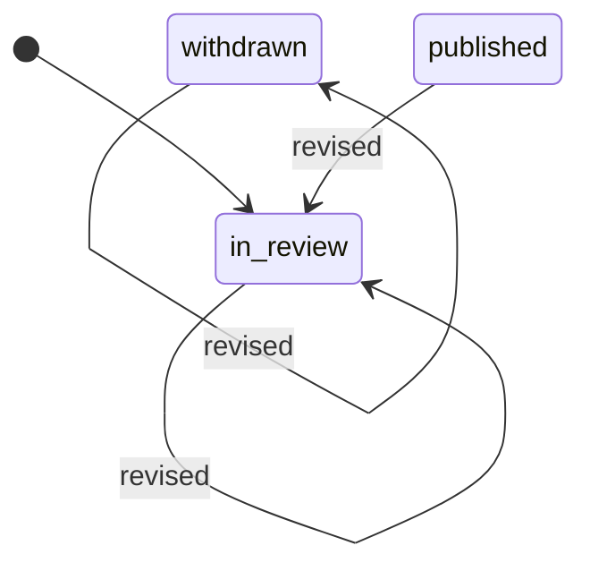
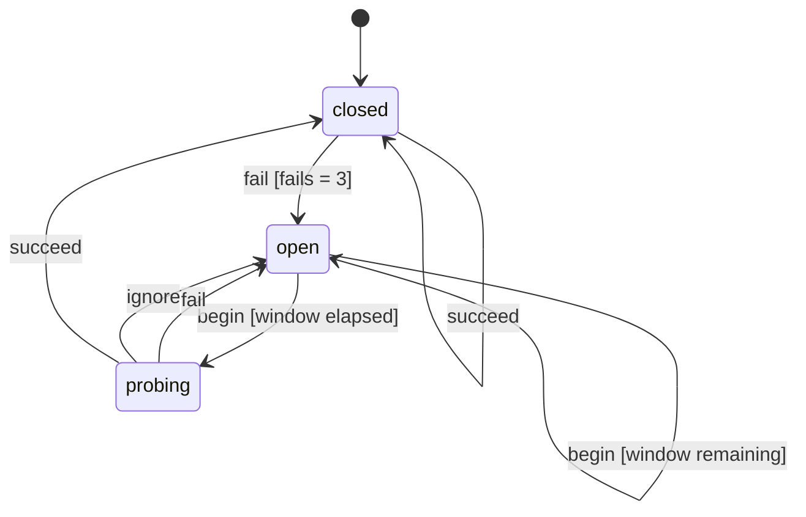
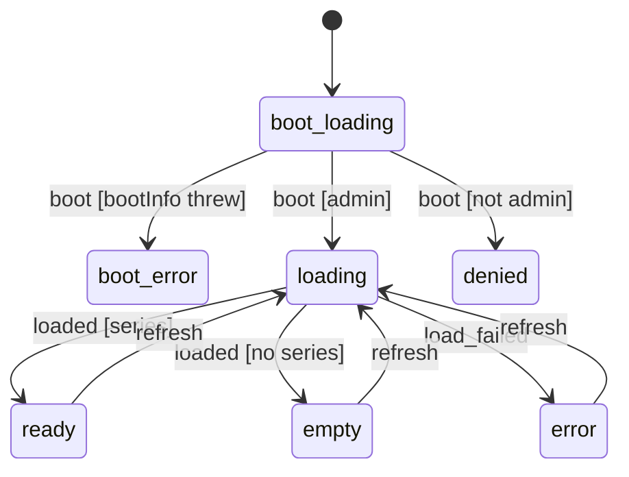
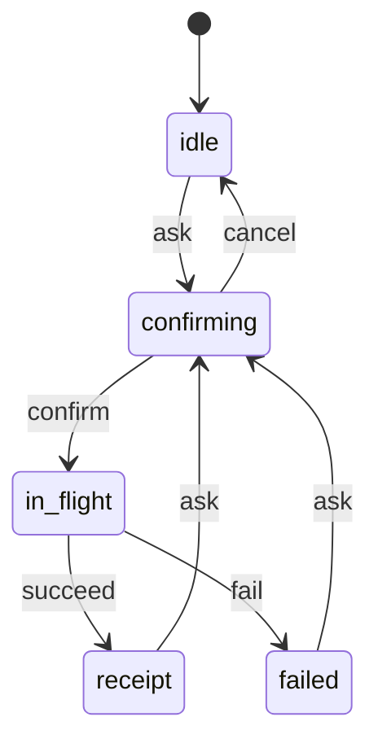
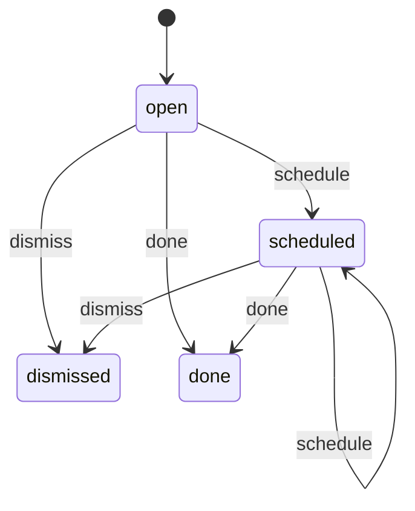

# State machines in ATLAS
Last reviewed: 2026-11-12 on `cursor/state-machines-atlas-v2`. This inventory is not pinned to a commit. Rows 9 and 18 record Tony's Q-9a ruling in the same commit as the `revised` change.

The rules are `docs/STATE-MACHINE-STANDARD.md`. This file keeps the ATLAS inventory and does not restate them. Row 9, story publication, is fixed in this branch. Rows 1, 7, 8, 12 and 15 cite code that is not on this branch. The other high-risk rows are still pending review.

## Inventory

Row shape: section 4 of `docs/STATE-MACHINE-STANDARD.md`. Status in the summary table is the decision; it becomes FIXED only in the commit that lands that machine.

| # | Machine | Location | Lifecycle | Flags / fields | Known bugs | Risk | Decision |
|---|---|---|---|---|---|---|---|
| 1 | Edge interview session | Not on this branch. `session.js` has no `hold` or `loudRun`. | One live interview: turn-taking, continuation hold, barge-in, playback, end | `hold`, `listening`, `continuing`, `echoable`, `acked`, `playbackDone`, `loudRun`, `gen`, queue | The earlier `session.js:126` hold and `loudRun` citation is not this branch. `session.js` is in the tree. Those flags are not. | H | LATER. Not reviewed here. |
| 2 | Edge interview ledger | `deploy/cloudflare-edge/src/ledger.js:15` | Which story field is open, recorded, or deferred during the interview | detail `status` strings, `next_field`, probe budget | None newly reproduced. | H | LATER. Pending review. It decides the next question. |
| 3 | Python interview run | `atlas_voice/cascade.py:154` `run` | Connect, speak, cancel, discard, end for the Kyutai/Workers cascade | task cancellation, `Discarded`, pacing notes | The cascade has no continuation window (`docs/LIVE_TEST_BOUND.md`). | H | LATER. Pending review. |
| 4 | Python interview ledger | `atlas_voice/quality.py:52` | Same field lifecycle as the edge ledger, on the hosted path | status strings on recorded details | None newly reproduced. | H | LATER. Pending review. |
| 5 | Python voice socket | `atlas_voice/server.py:166` (`active` at :47) | Connect, stream, cancel, end, error for one browser socket | `active[cookie]`, session expiry, generation implicit in the handler | None newly reproduced. A double start can occupy the one slot. | H | LATER. Pending review. |
| 6 | Browser voice phase | `src/voice-client.js:7` (`status()` at :37, `begin` at :67, `cancel` at :100, `fail` at :101) | idle, preparing, connecting, live, ending, error | `phase`, `generation`, `restarting`, `permissionPending`, `consentStarting`, `muted` | None newly reproduced. Illegal combinations (live without a socket) are possible if a handler returns early. | H | LATER. Pending review. |
| 7 | Live-test spend ledger | Not on this branch. `spend-ledger.js` is not in the tree. | Admit session, admit turn, reserve, claim, settle, latch stop | `stopped`, `sessions`, `open`, `reserved`, `claimed` | The earlier `spend-ledger.js:30` citation is not a file on this branch. | H | LATER. Not reviewed here. |
| 8 | Production day budget | Not on this branch. `meter.js` is not in the tree. | Reserve, record, settle, roll the UTC day | `day`, `open`, `reserved`, `limitUsd` | The earlier `meter.js:70` `BudgetState` citation is not a file on this branch. | H | LATER. Not reviewed here. |
| 9 | Story publication | `deploy/cloudflare-edge/src/publication.js` (`deriveStatus` is `publicationStatus`; `upsert` uses `revised`; `merge` uses `merged`) | in review, needs work, awaiting validation, changes requested, published, withdrawn, admin test | `validation.status`, `managerDecision`, `presalesDecision`, `withdrawn`, `quality.status`, `test`. `merged_into` stays a column. | `canPublish` requires both approvals. 32 of the 2560 golden rows move from `published` to `awaiting_validation` (validated, quality ready, not both approved, including both `merged_into` values). Unknown approvals still do not publish. A version-less row is a main row: it decodes through `publicationStatus` and is not rewritten. An unknown version keeps every stored field, including `withdrawn`. Its decoded status is `withdrawn` when the row is withdrawn, otherwise `in_review`. The read overlays nothing and persists nothing. CAS still compares the stored status column (`library.js:329`, `:434`, `:673`). `scanStale` (`library.js:824`) uses the decoded status, so an unknown withdrawn row is not invited even when the column is `published`. A legacy row whose column is `published` and whose story decodes to `awaiting_validation` is covered. A merge without `transactionSync` returns 503. A rejected reinstate says the story was merged only when `merged_into` is set; otherwise it uses `PUBLICATION_CHANGE_REFUSED`. `index` (`library.js:571`) parses every other row with the same guard as `visibleRows` before it writes a duplicate. Tony, Q-9a, verbatim: "Atlas withdrawn edit: stay withdrawn until a reviewer reinstates". An editor's content change on a withdrawn, non-merged story used to clear `withdrawn` and store `in_review`, which skipped reviewer-only reinstate. `revised` stays legal from `withdrawn` and keeps `withdrawn`. It still stores version 1, clears quality and test, and sets both lanes to pending. Only `reinstated` clears `withdrawn`. None of the 2560 `deriveStatus` goldens move, because `withdrawn` already wins before quality and lanes. Applying `revised` moves 1280 of those 2560 outcomes from `in_review` to `withdrawn`: every combination with `withdrawn` true, both `test` flags, all four qualities (missing, ready, needs_work, insufficient), all five validation statuses (missing, pending, validated, changes_requested, admin_bypass), both decisions over missing, pending, approved and changes_requested, and both `merged_into` values (missing and `keep-id`). The other 1280, `withdrawn` false, stay `in_review`. The earlier 16 bare rows (32 with `merged_into`) that moved `published` to `awaiting_validation` are unchanged. | H | FIXED. The reducer is the only writer of validation, withdrawn and test. `validated` does not publish without both lanes. Nine phase/event pairs are illegal. `revised` does not clear `withdrawn`. |
| 10 | Privacy erasure | `src/erasure-machine.js` (writer: the privacy button in `src/journey-ui.js`; journey match in `journey.js` `JOURNEY_MATCH`, used by `operate.js:145` and :166–:167) | idle, confirming, in flight, receipt, failed | `{status}` written only by `erasureTransition` | The button posted `/privacy/delete` on the first click and painted `JSON.stringify` of the response. A second click sent a second POST. `saveJourney` stores `user.email` unchanged. Read and save used `subject = ?`, so a lower-case sign-in missed a mixed-case row and the next save inserted another. Export returned the first match. Those four now share `lower(subject) = lower(?)` inside the tenant. Read and save pick the newest `updated_at`, then the greatest `rowid`. Export and erasure take every match. Existing duplicates are not merged. `complete` stays false. The v1 receipt at `journey-ui.js:11` and `confirmDelete` :81 is still not on this branch. | H | FIXED. One confirmation, one POST while in flight, and the server note instead of raw JSON. |
| 11 | Colleague confirm page | `deploy/cloudflare-edge/src/confirm-page.js:120` | Open a confirmation, submit, error | page fetches, request id | None newly reproduced. | H | LATER. Pending review. It records a human confirmation. |
| 12 | Early speculation | Not on this branch. `speculation.js` is not in the tree. | Off, admitted, cancelled, claimed by the final turn | `EARLY_STT`, `EARLY_DRAFT`, reservation ids, `scope` | The earlier `speculation.js:24` and `MemoryLedger` at :46 citation is not a file on this branch. | H | LATER. Not reviewed here. |
| 13 | Story-rating circuit breaker | `deploy/cloudflare-edge/src/breaker.js` (writer: `rating.js` `storyRater`) | closed, open for 60 s, one trial, auth block until the key changes | was `fails`, `openUntil`, `authKey`; now one object written only by `transition` | **Fixed.** The old `rating.js` admit cleared `openUntil` before the trial returned, so a second `rate()` was sent. `test/rating.test.js` R16b. A probing `ignore`, including a 429, goes back to open for a fresh 60 s. `storyRater` logs that move as phase and event only. Only `succeed` closes a probe. `auth_fail` while probing still closes it and records the key. `open` plus `succeed` is a rejection: `storyRater` logs it and the breaker stays open. `open` plus `fail` still settles. | M | FIXED |
| 14 | Admin metrics view | `src/admin-metrics-machine.js` (writer: `src/journey-ui.js` `renderAdmin`) | boot loading, boot error, denied, metrics loading, ready, empty, error; export | `{status}` written only by `adminMetricsTransition`. `bootFailed` is a separate guard from the role. The view is not stored, so it has no version field. | A failed boot used to show the verified-admin sentence. `renderAdmin` now sends `failed: true` and paints `boot_error`. | L | FIXED. A failed boot is `boot_error` and does not show the verified-admin sentence. |
| 15 | `LEDGER_MODE` | Not on this branch. `meter.js` is not in the tree. | none: the Worker boots in one mode | `env.LEDGER_MODE` (`off`, `observe`, `enforce`, anything else invalid) | The earlier `meter.js:31` `ledgerMode` citation is not a file on this branch. | L | LATER. Not reviewed here. |
| 16 | Rating quality status | `deploy/cloudflare-edge/src/rating.js:410` `noStoryQuality` | none | `ready` / `needs_work` / `insufficient` derived from the score | None. | L | NOT A MACHINE. Pure mapping from a score and blockers. Two or three labels, no transitions. |
| 17 | Per-call provider retry | `deploy/cloudflare-edge/src/classify.js:95`, `customer-jev.js:129`, `teams.js:98` | one call, up to three tries | local `attempt` counter | None. | L | NOT A MACHINE. The counter dies with the call. Nothing is persisted and nothing else reads it. |
| 18 | Story revision reopens approvals | `publicationTransition` event `revised`, called from `library.js` `upsert` | a content change clears quality and test, sets both approval lanes to pending, stores version 1, and leaves `withdrawn` set | `quality`, `withdrawn`, `test`, `validation.status`, `managerDecision`, `presalesDecision` | Tony, Q-9a, verbatim: "Atlas withdrawn edit: stay withdrawn until a reviewer reinstates". An edit used to clear `withdrawn` and reopen `in_review`. The golden revision of a published story still expects `in_review`. A withdrawn edit stays withdrawn until a reviewer reinstates, and that reinstate then derives `in_review` because the revision cleared quality. | H | FIXED. Folded into row 9. `revised` is the only writer of that reset, it stores version 1, and it does not clear `withdrawn`. |
| 19 | Interview invitation status | `deploy/cloudflare-edge/src/invitation.js` (writers: `library.js` `updateInvitation` at :785, guard :792, UPDATEs :813, :818, :819, :820; `outreach.js` guard :540–:542, `teams_seen` and the status update in one `transactionSync` at :554–:565 (`changes()` at :557); unique index `library.js:186`) | open, scheduled, dismissed, done | `invitations.status` written only after `invitationTransition`; `slot` is the schedule effect | A done or dismissed invitation could be scheduled again. When another open row already held that scope, the `invitations_open_scope` index threw and the route returned 500. | M | FIXED. One transition, a status compare-and-swap, and a 409 refusal. |
| 20 | JEV rating consent | `deploy/cloudflare-edge/src/profile.js:594` `storedConsent`; grant and revoke at :669; `library.js:371` `consentTenant`, `jevAllowed` at :376, `engineFor` at :377 | absent, or `{version:1}` for `jevRating`, one row per subject and tenant | `consents.jevRating` | A missing tenant argument is absent. It does not read the blank-tenant row. `jevAllowed` passes the story tenant only when it matches `TENANT_ID`. | L | NOT A MACHINE. Two stored values, written in one route. No intermediate state and no retry. The tenant is the row key, not a state. |
| 21 | Rating in flight per revision | `deploy/cloudflare-edge/src/library.js:444`–:464 `review` (`inflight` at :182; join :450–:456; `nextGen` :471; `storeRating` guard :479) | no entry, or one `{gen, engine}` for `id:revision`. The same engine joins. A different engine starts a new generation. | `this.inflight` | None newly reproduced. The map is the re-entrancy guard. | M | LATER. One rating at a time is an ordering rule. It is not the publication status. Not started in this run. |
| 22 | Artifact page lifecycle | `scripts/artifact_lifecycle.py` `transition` | One git tree: source changed, built, pinned, verified, deployed | The state name plus the fields that name carries. No booleans. | None. The reducer has no caller. Deploy still compares the committed pin. | L | FIXED for the reducer. Not wired to build, verify, or deploy. |

## Story publication
- Purpose: decide the status column from the story's quality, validation and withdrawal, reopen both approval lanes when the story is revised, and leave a withdrawn story withdrawn until a reviewer reinstates it.
- Code: `deploy/cloudflare-edge/src/publication.js`, tests: `deploy/cloudflare-edge/test/publication.test.js`, `test/publication-legacy.test.js` and `test/publication-golden.test.js`.
- Persisted: the story row. `revised` stores `version` 1. `readPublication` (`publication.js:107`) is the read path. Version 1 round-trips and keeps the column status. A row with no version decodes through `publicationStatus` and is not rewritten. main never stored a version, so that is every existing row. A value that is not a record is the fresh in-review record. An unknown version keeps every stored field. Its decoded status is `withdrawn` when `withdrawn` is set, otherwise `in_review`. The read does not mutate the stored object, does not overlay a fresh record, and does not rewrite the row. `loadPublication` (`publication.js:98`) copies a record and does not replace an unknown version. Compare-and-swap uses `storedStatus`, the column, at `library.js:329`, `:434` and `:673`. A merge without `transactionSync` returns 503 (`library.js:683`). A rejected reinstate uses the merged sentence only when `merged_into` is set; otherwise it uses `PUBLICATION_CHANGE_REFUSED` (`library.js:24`, `:920`). `revised` (`publication.js:206`–`:222`) keeps `withdrawn` and still stores version 1, clears quality and test, and sets both lanes to pending.

### States
| State | Data carried | Meaning |
|---|---|---|
| in_review | quality missing, or not yet reviewed | The revision has no usable rating. |
| needs_work | quality status other than ready | The rating is not ready to publish. |
| changes_requested | a changes request on the status or either lane | Someone sent it back. |
| awaiting_validation | quality ready, approvals not complete | Waiting for the lanes. |
| published | quality ready and both lanes approved | A `validated` flag without both approvals stays `awaiting_validation`. |
| admin_test | admin bypass and `test` | An admin test, not a customer claim. |
| withdrawn | `withdrawn` | Hidden. This wins over the other fields. |

### Events
| Event | Source |
|---|---|
| revised | `upsert` when the content hash changes, or on create |
| derive | a caller that already built the next state, and the golden table |
| merged | `merge`, for the story that is folded into another |
| reviewed | `storeRating`, when a rating is stored |
| decided | `validate`, one lane |
| admin_published | `adminPublish` |
| withdrawn | `withdraw` |
| reinstated | `reinstate` |

### Transitions
| From | Event | Guard | To | Side effects |
|---|---|---|---|---|
| every phase except withdrawn | revised | none | in_review, version 1, pending lanes, quality null, test cleared, withdrawn stays false | `upsert` stores the state and the status. CAS matches the stored status column |
| withdrawn | revised | none | withdrawn kept, version 1, pending lanes, quality null, test cleared | `upsert` stores the state and the status. Only `reinstated` clears withdrawn |
| any | derive | none | the status of the current fields | none inside the reducer |
| any | merged | none | withdrawn, other fields kept | `merge` stores that status and `merged_into` in the same transaction as the keeper revision |
| any | reviewed | none | quality replaced; validation, withdrawn and test unchanged | `storeRating` stores the state and the status. Legal from withdrawn so a rating already in flight can settle; withdrawn still wins the status |
| every phase except withdrawn | decided | `lane` is manager or presales, and the decision is approved or changes_requested | validation written by the reducer | `validate` stores the state and the status |
| every phase except withdrawn | admin_published | none | `test` and validation status `admin_bypass` written by the reducer | `adminPublish` stores the state and the status. It does not clear withdrawn, so it is illegal from withdrawn |
| every phase except withdrawn | withdrawn | none | withdrawn | `withdraw` stores the state and the status |
| withdrawn | reinstated | `mergedInto` is empty | withdrawn cleared | `reinstate` stores the state and the status |

Anything not in this table is illegal and is rejected. The cross product is 56 pairs. Nine are rejected: `withdrawn` with `withdrawn`, `decided` or `admin_published`, and `reinstated` from every phase except `withdrawn`. `withdrawn` with `revised` stays legal and keeps `withdrawn`. `reinstated` with `mergedInto` set is still rejected from withdrawn. The transition returns the previous state and a rejection marker. The caller logs the story id, the phase and the event, and does not store that result. A status write matches the revision and the stored status column, not the decoded status. `scanStale` (`library.js:824`) uses the decoded status, so a withdrawn row is not invited, including an unknown version whose column is still `published`. A malformed story JSON is skipped and logged by `visibleRows`, `exportAll`, `scanStale` and `index`. `index` (`library.js:571`) parses every other row before it writes a duplicate, so one bad row cannot leave a partial write. A parsed null state is unreadable: the id is logged, that row is not written, and the other rows continue. It does not fail the tenant.

### Platform / flag differences
None. `canPublish` is both approval lanes. The `validated` flag is not that guard.

A validation status outside `undefined`, `pending`, `validated`, `changes_requested` and `admin_bypass`, or a decision outside `undefined`, `pending`, `approved` and `changes_requested`, does not publish. Quality ready maps to `awaiting_validation`. Anything else that is not withdrawn maps to `in_review`. `publicationEffect` is that marker. `deriveStatus` logs the story id, the phase and the event. Before this, both approved decisions with an unknown status, and a `validated` flag with an unknown decision, derived `published` when quality was ready.

`deploy/cloudflare-edge/test/publication-golden.test.js` calls `deriveStatus` for every combination of the fields it reads, and checks that `merged_into` does not change the result.

Withdrawn wins. Then an unknown status or decision does not publish. Then `admin_bypass` (test, missing quality, quality not ready, or published). Then missing quality is `in_review`, and quality that is not `ready` is `needs_work`. A `changes_requested` on the status or on either decision is `changes_requested`. Both decisions `approved` is `published`. A `validated` flag without both approvals is `awaiting_validation`.

### Stale `validated`
`upsert` replaces `validation` with `pending` on both lanes and sets `quality` to null. A story that was not withdrawn derives `in_review`. A withdrawn story stays `withdrawn`. A later reviewer reinstate then derives `in_review`, because the revision cleared quality.

`canPublish` is both decisions `approved`. A hand-built `validated` flag with both decisions pending, or with only one approval, derives `awaiting_validation` when quality is ready. Both lanes approved still derives `published`. Admin bypass is a separate branch and is unchanged.

## Story-rating circuit breaker
- Purpose: stop calling TypeSafe for story ratings after repeated failures, allow one trial after 60 s, and stop calling with a key that was rejected until that key changes.
- Code: `deploy/cloudflare-edge/src/breaker.js`, tests: `deploy/cloudflare-edge/test/breaker.test.js`, regression: `deploy/cloudflare-edge/test/rating.test.js` (R16, R16b)
- Persisted: no. One LibraryStore holds it in memory. There is no snapshot codec and no version field.

### States
| State | Data carried | Meaning |
|---|---|---|
| closed | `fails` 0, 1 or 2; `authKey` or null | Ratings are sent. `fails` is how many counted failures have not yet opened it. |
| open | `until` (ms), `fails`, `authKey` or null | No rating is sent before `until`. `fails` can be 1 when a second failure note arrives in the request that opened it. |
| probing | `fails`, `authKey` or null | The one trial has been admitted and has not settled. Another admit is illegal. |

### Events
| Event | Source |
|---|---|
| begin | `storyRater.rate`, before the fetch |
| succeed | a 200 with a parseable answer |
| fail | timeout, network, or HTTP 500–599 |
| auth_fail | HTTP 401 or 403 |
| ignore | 429, a non-200 2xx, or any other ending. It does not count toward opening. |

### Transitions
| From | Event | Guard | To | Side effects |
|---|---|---|---|---|
| closed | begin | auth key does not match | closed | one normal rating (up to the budget's attempts) |
| open | begin | auth key does not match, and `now >= until` | probing | the one trial request |
| open | begin | `windowStillOpen` (`now < until`) | open | no request. `RatingError('circuit_open')` |
| closed or open | begin | `authKeyMatches` | same | no request. `RatingError('auth')` |
| probing | begin | none: the pair is illegal | probing | logged, no request. `RatingError('circuit_open')` |
| closed or probing | succeed | none | closed, fails 0, auth key kept | the rating is returned |
| open | succeed | the pair is illegal: the success is stale | open | `storyRater` logs the phase and the event. The window and the count stay |
| probing | fail | `state.phase === 'probing'`, with or without `event.trial` | open for 60 s, fails 0 | the trial failed |
| closed or open | fail | `event.trial`, or `fails + 1 >= 3` | open for 60 s, fails 0 | the rating fails |
| closed or open | fail | not a trial, and the count stays under 3 | closed, or open if a window was already set | the rating fails; retries follow the existing budget |
| any | auth_fail | none | same phase (probing becomes closed), auth key set | the rating fails |
| closed or open | ignore | none | same phase | the rating fails; the count is unchanged |
| probing | ignore | the trial outcome is not a success | open for 60 s, fails 0 | `storyRater` logs `{atlas_metric:'breaker', phase:'open', event:'ignore'}`. `transition` does not log. The key is not in the line |

Anything not in this table is illegal and is rejected. The transition returns the previous state and a rejection marker. `storyRater` logs the phase and the event. It does not carry the key. Effects (the fetch, the retry sleeps, the `RatingError`) run in `storyRater`, not in `transition`.

`open` plus `fail` stays a legal settlement. A rating admitted while the breaker was closed can still be running when another failure opens it, and that failure still settles. `open` plus `succeed` is the stale pair in the table above: the open window is already the failure outcome, so a late success is a rejection. `storyRater` logs the phase and the event, and the breaker stays open. `transition` itself does not log. An `ignore` while probing, including a 429, opens a fresh 60 s window. Only `succeed` closes a probe. `auth_fail` while probing still closes it and records the key; that does not conflict with the reopen, because an auth failure is still recorded against the key and the next call with that key stays blocked.

### Platform / flag differences
None. The auth-key guard reads the key the rater was constructed with. It is not an operating-system fork.

## Admin metrics view
- Purpose: show an admin either the loading line, the not-admin refusal, the metrics, an empty range, or the load error, and keep export on the shell.
- Code: `src/admin-metrics-machine.js`, tests: `tests/admin-metrics-machine.test.js`. `renderAdmin` paints. `build.py` copies the machine into the page with the export keywords removed, because the page is a classic script.
- Persisted: no. There is no snapshot codec. Nothing stores the view.

### States
| State | Data carried | Meaning |
|---|---|---|
| boot_loading | none | "Loading admin metrics…" |
| boot_error | none | `bootInfo()` threw, or the boot has no ATLAS protocol. The page paints `show_boot_error`. |
| denied | none | The boot call resolved and the role is not admin. |
| loading | none | The shell is up and the metrics pane says "Loading…". Export is available. |
| ready | none | Metrics are shown, and the series is not empty. The numbers stay in the effect, not in the state. |
| empty | none | The same cards, plus "No events in this range." |
| error | none | The metrics pane is the warning. Export is still available. |

### Events
| Event | Source |
|---|---|
| boot | `bootInfo()` resolved, or threw (`failed: true`) |
| refresh | the first load and the Update button |
| loaded | a metrics response, with `count` = `series.length` |
| load_failed | the metrics request threw, or the body had no series |
| export | Export CSV |
| export_failed | the export request threw |

### Transitions
| From | Event | Guard | To | Side effects |
|---|---|---|---|---|
| boot_loading | boot | `bootFailed` | boot_error | `show_boot_error`. The page paints the existing metrics-failed sentence |
| boot_loading | boot | not `bootFailed`, and `isAdminRole` | loading | mount the shell, fetch metrics |
| boot_loading | boot | not `bootFailed`, and the role is not admin | denied | the not-admin warning |
| loading, ready, empty, error | refresh | none | loading | show "Loading…", fetch metrics |
| loading, ready, empty, error | loaded | `hasSeries` | ready | paint the cards and the chart |
| loading, ready, empty, error | loaded | count is 0 | empty | paint the cards and the empty sentence |
| loading, ready, empty, error | load_failed | none | error | the warning |
| loading, ready, empty, error | export | none | same | download the CSV |
| loading, ready, empty, error | export_failed | none | same | append the warning under the pane |

Anything not in this table is illegal and is rejected. The transition returns the previous state and a rejection marker. `renderAdmin` logs the status and the event, and does not change the pane.

### Platform / flag differences
None for this view. `LEDGER_MODE` is a guard input on the paid-call wrapper, not a machine (row 15). Neither fixed machine forks by operating system.

`renderAdmin` sends `failed: true` when `bootInfo()` throws or the boot has no ATLAS protocol. That is `boot_error`. The pane says "Metrics failed." and does not say "This dashboard is only for a verified admin. The API refuses everyone else." A resolved boot whose role is not admin still takes `denied` and that sentence.

## Privacy erasure
- Purpose: ask before deleting, send one deletion request, and show the server's note instead of the raw JSON body.
- Code: `src/erasure-machine.js`, tests: `tests/erasure-machine.test.js` and `tests/erasure-button.test.js`. The journey match is `JOURNEY_MATCH` in `deploy/cloudflare-edge/src/journey.js` (`:78`), used by read, save, export (`operate.js` `journeyExport`) and erasure (`JOURNEY_COUNT_SQL`). Profile read, write, export and erasure share `profileSelection` in `deploy/cloudflare-edge/src/profile.js`. The fold is JavaScript `trim` and `toLowerCase` (Unicode default case conversion, every whitespace character). It is not SQLite `lower()` or `trim()`. Writes store that fold. The newest parsed `updated_at`, then the greatest `rowid`, is the profile a read or an export returns. Further folded matches in the verified tenant are omissions with reason `duplicate`, and erasure deletes every one of them. They are not merged. A legacy subject-only row is copied with tenant `''` and stays stored. Export names it `{ source: 'profile', reason: 'legacy_unscoped' }` and does not include its content. Erasure does not delete it, and it is not treated as another tenant's row. An operator resolves it by a reviewed migration that assigns the tenant. `quarantineReport` does not write one. Exact duplicate subjects in a legacy table keep that same newest row, and the dropped rowids are recorded as `duplicate`. `migrateProfiles` and `migrateDirectory` share one `transactionSync` (`profile.js:197`). A store without `transactionSync` throws and does not migrate. A stranded `profiles_v2` or `directory_v2` is renamed back when the live table is missing or empty. When the live table is still the old shape, the parked copy is dropped and the copy runs again. When both tables are already current and both have rows, ensure throws and drops nothing. `ownerKeys` (`library.js:228`) uses `profileSelection`. `personAliases` (`outreach.js:135`) keeps its alias walk and filters the tenant with `profileFold`, because one subject lookup would miss a row found only by its email. An enforced daily purge (`profile.js:607`) matches the stored tenant with `profileFold` and deletes the stale rowids through `writeChunks` (`sql-bound.js`), at most 100 bound parameters per statement, inside one `transactionSync` (`profile.js:624`). The same helper chunks every other list that grows with aliases, ids, or rows. An unenforced scan does not purge profiles, including blank-tenant rows. The unenforced blank-scope directory-cache and staged-import purge (`profile.js:632-638`) predates that profile rule and does not delete profiles. `storedConsent` (`profile.js:594`) has no default tenant. `jevAllowed` (`library.js:376`) and `engineFor` (`library.js:377`) pass the story tenant only when it matches `TENANT_ID`. Tests: `deploy/cloudflare-edge/test/privacy-delete.test.js` and `test/journey-subject.test.js`. `build.py` copies the machine into the page with the export keywords removed.
- Persisted: no. There is no snapshot codec. An unknown phase is rejected and left as it was.

### States
| State | Data carried | Meaning |
|---|---|---|
| idle | none | The delete button is available. Nothing has been sent. |
| confirming | none | The existing confirm dialog is open. Cancel sends nothing. |
| in_flight | none | The one POST is open. Another ask or confirm is illegal. |
| receipt | none | The server note and each outcome are shown only when every store succeeded. The JSON body is not. A receipt never contains `delete-failed`. |
| failed | none | The request was non-2xx, or an outcome carried an error. The warning banner shows the error. No receipt is appended. |

### Events
| Event | Source |
|---|---|
| ask | Delete my journey data |
| cancel | the confirm dialog closes without Continue |
| confirm | Continue |
| succeed | `/privacy/delete` resolved and every outcome has no error |
| fail | `/privacy/delete` was non-2xx, or any outcome has an error |

### Transitions
| From | Event | Guard | To | Side effects |
|---|---|---|---|---|
| idle, receipt, failed | ask | none | confirming | open the confirm dialog and disable the button |
| confirming | cancel | none | idle | close nothing further; the button is available |
| confirming | confirm | none | in_flight | POST `/privacy/delete` once |
| in_flight | succeed | none | receipt | paint the server note and each outcome |
| in_flight | fail | none | failed | the existing warning banner; no receipt |

Anything not in this table is illegal and is rejected. The cross product is 25 pairs. Seven are legal. The transition returns the previous state and a rejection marker whose only fields are `id`, `phase` and `event`. The id is `privacy-delete`. The button logs that marker. The transition does not log, and it does not receive the email, the note, or the response body.

### Platform / flag differences
None.

### Copy
The button stays `Delete my journey data`. Download stays `Download my data`. The server note and the disclosure sentences are unchanged. The confirm dialog's existing buttons stay `Continue` and `Cancel`. The one new string is the confirm message: `Continue sends the deletion request. Cancel sends nothing.` The receipt lines are the server note, then each outcome as the store name, a space, and either the removed count or the server error string. No other sentence was added.

`saveJourney` (`journey.js`) stores `user.email` as given when it inserts. Read, save, export and erasure share `lower(subject) = lower(?) AND tenant = ?`. When more than one row already matches, read and the following save use the newest `updated_at`, then the greatest `rowid`, and that save changes only that row. Export and erasure take every match. This does not merge the duplicates. The index is `journey_tenant_subject` on `(tenant, lower(subject))`, created by `ensureJourney`.

## Interview invitation status
- Purpose: keep a closed invitation closed, and refuse a re-open instead of letting the open-scope unique index return 500.
- Code: `deploy/cloudflare-edge/src/invitation.js`, tests: `deploy/cloudflare-edge/test/invitation-status.test.js`. Writers: `library.js` `updateInvitation` and `outreach.js` `system`.
- Persisted: `invitations.status`. There is no version column. An unknown status is rejected and the row is not rewritten.

### States
| State | Data carried | Meaning |
|---|---|---|
| open | invitation id | No slot yet. |
| scheduled | invitation id | A slot is set. |
| dismissed | invitation id | Closed. |
| done | invitation id | Closed, with a reference. |

### Events
| Event | Source |
|---|---|
| schedule | `updateInvitation` action `schedule`, or a Teams snooze |
| dismiss | `updateInvitation` action `dismiss`, or a Teams decline |
| done | `updateInvitation` action `done` |

### Transitions
| From | Event | Guard | To | Side effects |
|---|---|---|---|---|
| open, scheduled | schedule | none | scheduled | set the slot. The UPDATE also requires `status IN ('open','scheduled')` |
| open, scheduled | dismiss | none | dismissed | the same compare-and-swap |
| open, scheduled | done | the existing reference checks | done | the same compare-and-swap, and the reference id |

Anything not in this table is illegal and is rejected. The cross product is 12 pairs. Six are legal. The transition returns the previous state and a rejection marker whose only fields are `id`, `phase` and `event`. The id is the invitation id. The email is not in the marker. `noteInvitation` logs that marker. The transition does not log. `updateInvitation` answers 409. The Teams card keeps its existing closed card. A compare-and-swap that changes no row is the same refusal.

### Platform / flag differences
None.

### Copy
The Teams card still says `This invitation is closed.` and `Nothing was changed.` The library refusal joins those two existing sentences: `This invitation is closed. Nothing was changed.` No other sentence was added.

## Artifact page lifecycle

- Purpose: name the legal steps from a source change to a publish for one git tree, and refuse a publish that has no verified packet for that tree.
- Code: `scripts/artifact_lifecycle.py`, tests: `tests/test_artifact_lifecycle.py`.
- Persisted: no. The packet version is the integer 1. `True`, `1.0`, and `"1"` are not that version. Loading any of those, version 0, a missing version, a later version, or a packet with no tree returns `IllegalTransition`. The built length field is `bytes`. `g_stale_pin_file` is on `pin_ok` and `publish_ok`. `g_verified_packet` reads the packet on the state and does not take one from the event. The reducer does not write the packet. A `deploy_record` is optional; when it is present its `packet_sha256` has to be the packet digest, and a non-dict record is refused. A packet pin that names a different page is refused at publish. An edit copies the event head and tree, which are not the head and tree already on the state. Nothing in the page pipeline calls this module yet. P2 is the first caller. P3 connects `publish_ok` to deploy.

`build.py`, `scripts/verify_page_build.sh`, `deploy/cloudflare-edge/deploy.sh`, and `scripts/check_handoff.py` do not call it. The cross product is 50 pairs. Fourteen are legal. `publish_ok` from `SourceChanged`, from a `Verified` state with no packet, from a packet whose `verified` flag is false, or from a packet whose tree is not the checkout tree, is illegal. A publish with no deployment id stays `Verified`.

### Platform / flag differences
`ATLAS_HOME_URL` is a field on the pin line. The reducer does not read the environment. A different token on that line does not refuse `pin_ok` or `publish_ok` when the page hash and the `ATLAS_HOME` origin match.
