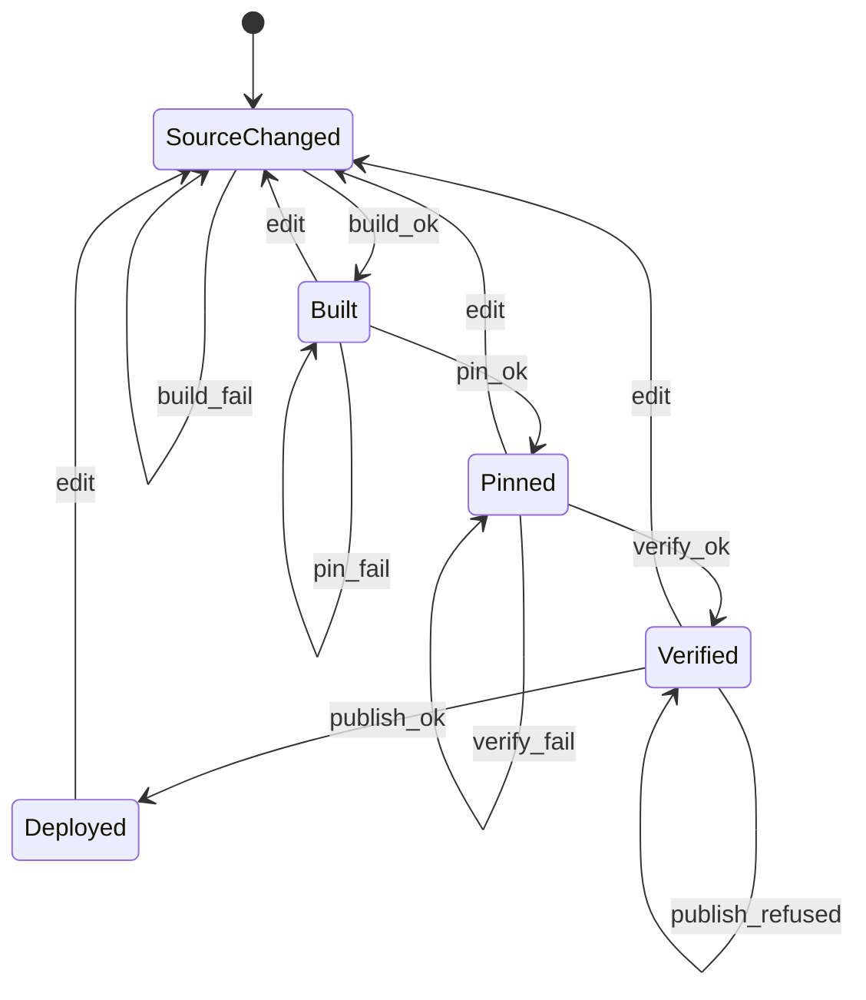

# Plan: build generated files and pages in the pipeline (R1+R2)

Plan phase only. Revision 1 (loop 1 of 3) edits this plan, adds its `MANIFEST.json` row, and adds `handoff/decisions/r1-r2-pipeline-plan-revision-1.md`. No product code, no pipeline code, no deploy, no secret, no edit to a workflow timeout, and no Cloudflare setting.

Base of this plan: `main` `8b0972ecf68228ab4a3bab5e4e90ffd5948826ec` (merge of PR #14).

Tony approved the direction of R1 and R2. Coding starts after pull requests #15–#21 have merged. Each implementation PR is still its own gate. This document does not merge them.

## Revision 1

Debate on `cad889f5ca558da902f93a407101bae60d558dc7`: CONSENSUS NOT YET. Report sha256 prefix `9cab4ebb` (`/workspace/atlas-gate/PLAN-DEBATE-atlas-22-cad889f.md` on the Atlas box). This revision is loop 1 of 3. The plan freezes after it. The decision record is `handoff/decisions/r1-r2-pipeline-plan-revision-1.md`.

The six fixes live in the sections below. The manifest row is in `MANIFEST.json`, not in an exclude list. The publish guard, the tree binding, the deploy lookup, and the base fetch are in sections 2 and 3. The Actions-budget precondition is in section 2. P3 and P4 each have their own rollback step and test. The packet witness is in section 2. Phase numbers are P1 through P6 in every section. `MANIFEST.json` leaves git in P5. `handoff/BUILD_STATUS.md` leaves git in P6.

## Scope fence

R1 is `MANIFEST.json` and `handoff/BUILD_STATUS.md`. R2 is the four HTML aliases and `deploy/cloudflare-edge/generated/PAGE_SHA256.txt`. `deploy/cloudflare-edge/src/csp.generated.js` is written by the same `build.py` run as the pages. This plan puts it in the R2 cutover. Question 1 asks the debate to strike it if it should stay committed.

Left where they are:

- `deploy/cloudflare-edge/src/policy.generated.js`. Another generator (`deploy/cloudflare-edge/build_edge.py:37-49`). CI already fails a stale copy (`.github/workflows/ci.yml:24-25`).
- `deploy/cloudflare-edge/src/atlas.html`. Already gitignored (`deploy/cloudflare-edge/.gitignore:1`). Deploy and the local edge copy the built page onto it.
- Commit `52742f80`. `SECOND_BRAIN.md:67` records it as `cursor/worker-coverage-gaps-59c9`, one unpushed test commit on `80bab333`, not an ancestor of the ledger chain. This sequence does not cherry-pick, push, or edit it. The same sentence is at `SECOND_BRAIN.md:44`.
- No identifier `D3` exists in this tree. `docs/state-machines.md:14` row 3 is the Python interview run (`atlas_voice/cascade.py:154`), status LATER. This sequence does not schedule that machine and does not edit `cascade.py`.

## Why these files collide

Every open PR in the named queue edits the same generated paths. Name-only diffs against their heads, read on 2026-11-20. All seven are drafts. All seven use base `main`. They are parallel, not a GitHub stack.

| PR | Head branch | Generated paths in the diff |
|---|---|---|
| #15 | `cursor/atlas-identity-change-residual` | four HTML aliases, `MANIFEST.json`, `PAGE_SHA256.txt`, `csp.generated.js`, `handoff/BUILD_STATUS.md` |
| #16 | `cursor/atlas-record-dialog-lows` | four HTML aliases, `MANIFEST.json`, `PAGE_SHA256.txt`, `csp.generated.js`, `handoff/BUILD_STATUS.md` |
| #17 | `cursor/atlas-rating-onend-throw` | `MANIFEST.json`, `handoff/BUILD_STATUS.md` |
| #18 | `cursor/atlas-askrunner-count` | `MANIFEST.json`, `handoff/BUILD_STATUS.md` |
| #19 | `cursor/atlas-sqltext-lows` | `MANIFEST.json`, `handoff/BUILD_STATUS.md` |
| #20 | `cursor/atlas-long-title-overflow` | four HTML aliases, `MANIFEST.json`, `PAGE_SHA256.txt`, `handoff/BUILD_STATUS.md` |
| #21 | `cursor/atlas-checkhandoff-residuals` | `MANIFEST.json`, `handoff/BUILD_STATUS.md` |

Also open, and outside this queue: #1 (`feature/agent-brain-v2.1`, base `main`), #2 (`cursor/plan-a-cap-v2`, base `main`), #4 (`cursor/atlas-preview-gate8`, base `cursor/plan-a-cap-v2`). This sequence does not stack on them. If one of them still carries these paths when the cutover lands, it follows the same in-flight rule at the end of this plan.

The four aliases are one byte string. `MANIFEST.json:624-641` lists each at 924015 bytes and sha256 `7a290026b91b2e3f732b31146927a158bb30243ed2bea6fd74f517ae31dd7d4a`. `handoff/BUILD_STATUS.md` is 346929 bytes (`MANIFEST.json:2284-2286`). A one-line status note changes that row, so the manifest rewrite follows the status edit. `handoff/BUILD_STATUS.md:1632` and `:1641` record that order: the note is written, then `python3 scripts/check_handoff.py . --dev-git-index --write-manifest`.

`docs/WOW_SPEC.md:1506` already said each track rebuilds the aliases and does not commit them, and that CI builds its own copy. The integration step was supposed to commit them once (`docs/WOW_SPEC.md:1498`). The current tree commits them on every PR. CI's build is `bash scripts/verify_page_build.sh` (`.github/workflows/ci.yml:22-23`), which runs `build.py` twice and then compares the result to the committed page (`scripts/verify_page_build.sh:39-48`).

## 1. Inventory

Line numbers are from `8b0972ec`. A path that only stores a past session is listed once, at the line that shows the read or the write.

### 1.1 Writers

| Writer | Lines | What it writes |
|---|---|---|
| `build.py` | 69-72 | `deploy/cloudflare-edge/src/csp.generated.js` from `script_hashes` of the assembled page |
| `build.py` | 73-79 | The same byte string to `ATLAS_Project_Intelligence.html`, `ATLAS_Intelligence.html`, `ATLAS_Voice_Studio.html`, `ATLAS_Voice.html`. The three `title` replaces run before those four writes. |
| `build.py` | 15-25, 55 | `ATLAS_HOME` from `ATLAS_HOME_URL` or `deploy/cloudflare-edge/wrangler.jsonc` `vars.ORIGIN`, baked into the page |
| `scripts/check_handoff.py` `write_manifest` | 359-368 | Rewrites `MANIFEST.json` `files` (path, bytes, sha256). Leaves the header keys, including `"date": "2026-09-26"` (`MANIFEST.json:4`). |
| `scripts/check_handoff.py` CLI | 622-644 | `--write-manifest` requires `--dev-git-index`, refuses a missing manifest, refuses a non-checkout, refuses a non-ASCII path, then calls `write_manifest`. |
| `scripts/verify_page_build.sh` | 41, 66 | Runs `python3 build.py`, which writes the four aliases and `csp.generated.js`. The script does not write the pin. |
| `scripts/verify_page_build.sh` | 60 | Copies `ATLAS_Voice.html` to `deploy/cloudflare-edge/src/atlas.html` (gitignored). |
| `deploy/cloudflare-edge/deploy.sh` | 18-24 | Runs `python3 ../../build.py`, then copies `ATLAS_Voice.html` to `src/atlas.html`. Does not write the pin. |
| `deploy/cloudflare-edge/build_edge.py` | 44-49 | Writes `policy.generated.js`. The full run copies `ATLAS_Voice.html` onto `src/atlas.html`. `--policy-only` skips that copy. |
| Authors, by rule | `CLAUDE.md:35` | Append `handoff/BUILD_STATUS.md`. No program writes that file. |

There is no program that writes `PAGE_SHA256.txt`. The current line was written by hand from `sha256sum` (`handoff/decisions/page-pin-refresh.md:68`). The file is one line:

```
7a290026b91b2e3f732b31146927a158bb30243ed2bea6fd74f517ae31dd7d4a  924015  ATLAS_HOME=https://atlas.tony-walteur.workers.dev  ATLAS_HOME_URL=unset
```

`scripts/check_handoff.py:345` drops `MANIFEST.json` itself from the git file list. `MANIFEST.json:9-11` excludes only itself. Every other tracked path, including the four pages, the pin, `csp.generated.js`, and `handoff/BUILD_STATUS.md`, is a manifest row. Adding one tracked file makes `manifest-content` fail until the rewrite.

### 1.2 Makefile targets

`Makefile`:

| Target | Lines | Relation |
|---|---|---|
| `build` | 3-4 | `python3 build.py`. Writes the four aliases and `csp.generated.js`. |
| `preview` | 5-6 | Depends on `build`, then `scripts/preview.py`. |
| `gateway` | 7-8 | Depends on `build`, then `scripts/start_gateway.sh`. |
| `test` | 9-11 | Depends on `build` and `test-edge`, then `node --test tests/*.test.js` and pytest. |
| `test-edge` | 12-13 | Edge tests only. Does not build. CI runs the page build before this (`ci.yml:22-29`). |
| `test-ui` | 16-42 | Depends on `build`, then the browser scripts. |
| `doctor` | 43-44 | Does not build. `scripts/doctor.py:77-78` requires the compiled HTML to already exist. |
| `verify-package` | 45-48 | `scripts/check_handoff.py` on an extracted release. Reads that package's `MANIFEST.json`. |
| `verify-dev-tree` | 49-51 | `scripts/check_handoff.py . --dev-git-index`. Not a CI step. |

`tests/test_handoff.py:113-117` (`test_complete_make_targets`) locks that the Makefile still names `tests/test_*.py` and `tests/depth_browser.py`. `tests/test_handoff.py:703-714` locks the `verify-package` usage string and locks that the `test` recipe does not call `verify-package`.

### 1.3 CI and deploy steps

`.github/workflows/ci.yml`:

- 22-23. "Build the page twice and check the canonical hash" runs `bash scripts/verify_page_build.sh`.
- 24-25. `build_edge.py` then `git diff --exit-code` on `policy.generated.js` only. `csp.generated.js` is not in that diff.
- 26-37. Unit tests, edge tests, pytest, browser suites. They read the pages the verify step just wrote.
- No step runs `check_handoff.py`. `timeout-minutes` is 30 (`ci.yml:12`). This plan does not change that number.

`.github/workflows/deploy.yml`:

- 5-9. `workflow_dispatch`, input `confirm`.
- 14-16. Job runs only when `confirm == DEPLOY` and `github.ref == refs/heads/main`.
- 26-30. `bash deploy/cloudflare-edge/deploy.sh` with the two Cloudflare secrets. `timeout-minutes` is 15 (`deploy.yml:18`). This plan does not change that number, the environment name, the ref check, or the secret names.

`deploy/cloudflare-edge/deploy.sh`:

| Lines | Step | Exit |
|---|---|---|
| 18-20 | `python3 ../../build.py` | 11 `build` |
| 22-24 | copy to `src/atlas.html` | 12 `copy` |
| 26-28 | `node --test test/*.test.js` | 13 `test` |
| 30-37 | read `generated/PAGE_SHA256.txt` field 1 and compare to `sha256sum src/atlas.html` | 14 `hash` |
| 39-45 | stub, or `npx --yes wrangler@4 deploy` | 0 |

The hash runs after the tests because the tests can rewrite the page (`deploy.sh:4-5`). A failed build leaves a page that was already there (`page-guard.test.js:95-106`).

`scripts/verify_page_build.sh` exits, from the script and from `handoff/decisions/page-pin-refresh.md:88`:

| Exit | Lines | Meaning |
|---|---|---|
| 23 | 34-36, 42-44, 51-53, 67-69 | Committed page missing, or `build.py` did not write an alias |
| 24 | 46-48 | Fresh build differs from the committed snapshot |
| 25 | 55-57 | An alias differs from `ATLAS_Voice.html` |
| 21 | 71-74 | Second build differs from the first |
| 22 | 79-82 | Edge copy differs |
| 1 | 84-86 | Pin digest differs. The compare is the bare command `test "$actual" = "$expected"`. |
| 130 / 143 | 28-29 | INT / TERM |

The script unsets `ATLAS_HOME_URL` (`verify_page_build.sh:6`) before either build.

### 1.4 `check_handoff.py` rules

`inspect` (`scripts/check_handoff.py:371-516`) records these checks:

| Check | Line | What it requires |
|---|---|---|
| `manifest` | 377-379 | `MANIFEST.json` parses. Failure returns immediately. |
| `manifest-entries` | 381 | `files` is a non-empty list. |
| `manifest-content` | 386-460 | Each row's bytes and sha256 match the file. No duplicate, symlink, escape, missing file, unlisted path, or refused git metadata. Dev mode also refuses untracked files that are not excluded (`426-428`) and a checkout that is not exactly `.git/HEAD` (`415-423`). |
| `required:<path>` | 461-462 | Eight handoff files exist. `handoff/BUILD_STATUS.md` is not in this list. |
| `release-hygiene` | 463-472 | No font, key, sqlite, real `.env`, or secret-shaped directory in the manifest rows. |
| `html-aliases` | 473-486 | The four alias names are byte-identical. |
| `logo` | 487-492 | `assets/Mantu.svg` sha256 is `92c5ff21779f09199097a2971c172453017f0d2581a0ced6f54fe486ba9b6c2b`. |
| `html-logo-files` | 478, 483, 494 | Used when an alias or the logo cannot be read. |
| `clean-build` | 495-511 | `build.py` exits 0 in a temp directory. Timeout 30 seconds. Env is the seven names in `rebuild_environ` (`tests/test_handoff.py:758-767`). |
| `clean-build-byte-match` | 512-514 | The temp rebuild matches the four alias bytes in the package. |

Clean-rebuild copy set (`include_in_clean_rebuild`, `321-322`): `build.py` and paths under `src/`, `assets/`, `docs/`, `atlas_voice/`, `deploy/cloudflare-edge/`. `scripts/` is not copied. A pin helper that `build.py` imported from `scripts/` would break this rebuild. `build.py` stays on its current imports.

`manifest_allows_path` (`301-315`): a trailing-slash exclude hides a directory only in dev mode. Package mode ignores that form.

`tests/test_handoff.py:728-737` (`test_docs_do_not_use_the_checker_as_a_dev_gate`) forbids `00_START_HERE.md` and `handoff/BUILD_PLAN.md` from telling a reader to run the checker before editing, and it requires the sentence "enumerates package files except itself" to remain in `handoff/verification/RESULTS.json`. Later doc edits have to keep that test green.

Real-tree tests that read the committed manifest and the committed aliases:

| Test | Lines | What it does |
|---|---|---|
| `test_repository_full_handoff_includes_clean_rebuild` | 717-725 | `inspect` on the repo with `dev_git_index=True` and rebuild. |
| `test_git_archive_of_head_passes_check_handoff` | 740-753 | `git archive HEAD` is treated as the release package and must pass package-mode `check_handoff.py`. |
| `test_make_verify_package_requires_an_extracted_package` | 703-714 | Bare `make verify-package` fails. A synthetic package passes. |
| `test_write_manifest_requires_explicit_dev_git_index` | 418 | `--write-manifest` without the flag is an error. |
| `test_write_manifest_refuses_non_ascii_path` | 1213 | Write leaves the manifest bytes unchanged. |
| `test_disguised_checkout_write_manifest_exits_clean` | 1248 | Same, for a disguised git dir. |
| `test_git_failure_on_exact_dotgit_write_manifest_is_clean` | 1268 | Git failure on `--write-manifest` exits 2 and does not write. |

The other `test_handoff.py` tests build a synthetic package. They stay on package mode.

### 1.5 Page and pin consumers

Runtime:

| Consumer | Lines | Read |
|---|---|---|
| `atlas_voice/server.py` | 123 | Reads `ATLAS_Voice.html` for a signed-in response. |
| `atlas_voice/server.py` | 415 | `GET /ATLAS_Voice.html` uses that handler. `Makefile:7` builds before the gateway. |
| `scripts/preview.py` | 8, 21-24 | Serves `ATLAS_Voice_Studio.html`. Missing file is 503 "Run python3 build.py first". `Makefile:5` builds first. |
| `deploy/cloudflare-edge/src/worker.js` | 3, 20 | `import page from './atlas.html'` and passes it to `handle`. |
| `deploy/cloudflare-edge/dev/local-edge.mjs` | 27-29 | `readCanonicalPage` on `src/atlas.html` and `ATLAS_Voice.html`. |
| `deploy/cloudflare-edge/dev/page-guard.mjs` | 5-9 | Serves the edge file. If the root alias exists and differs, it throws. |
| `deploy/cloudflare-edge/src/csp.js` | 15 | Imports `PAGE_SCRIPT_HASHES` and `RUNTIME_BLOCK` from `csp.generated.js`. |
| `scripts/doctor.py` | 77-78 | Requires `ATLAS_Project_Intelligence.html` and `ATLAS_Voice.html` on disk. |
| `scripts/runpod_bakeoff.sh` | 68 | Rsync exclude of three aliases. `ATLAS_Voice.html` is not excluded. |
| `scripts/capture_pr10_evidence.py` | 160, 193, 222-225 | Reads the four aliases. |
| `scripts/capture_v12.py` | 8 | Reads `ATLAS_Project_Intelligence.html`. |
| `scripts/measure_journey_overflow.py` | 71 | Reads `ATLAS_Project_Intelligence.html`. |

Pin readers:

| Consumer | Lines | What it compares |
|---|---|---|
| `scripts/verify_page_build.sh` | 84-86 | Field 1 of the pin file to `sha256sum ATLAS_Voice.html`. |
| `deploy/cloudflare-edge/deploy.sh` | 30-36 | Field 1 to `sha256sum src/atlas.html`. Missing file exits 14. |
| `tests/page-pin.test.js` | 12, 16-20, 79-90 | Digest and byte count of all four aliases. `atlas.html` only when `git ls-files` tracks it. |
| `tests/page-pin.test.js` | 95-151 | Same-length byte flip, one-nibble pin flip, wrong pin, tampered page, missing page, build that writes `ATLAS_Voice.moved.html`. |
| `deploy/cloudflare-edge/test/page-guard.test.js` | 95-145, 147-159 | Deploy exits 11 and 14, stub deploy once, verify exits 21, 22, 130, 143. Plants `PAGE_SHA256.txt` in a fake tree. |
| `scripts/check_handoff.py` | 406, via the row | The pin file is hashed like any other listed file. A stale pin whose own bytes match its row still passes (`handoff/decisions/page-pin-refresh.md:21`). |

`node --test tests/*.test.js` and pytest do not read `PAGE_SHA256.txt` except `tests/page-pin.test.js` (`handoff/decisions/page-pin-refresh.md:21`). `make test` does not run `verify_page_build.sh`.

Browser and Python tests that read a committed alias at import or at the start of the file:

| File | Line | Alias |
|---|---|---|
| `tests/admin_metrics_browser.py` | 9 | `ATLAS_Project_Intelligence.html` |
| `tests/ask_browser.py` | 11 | `ATLAS_Voice.html` |
| `tests/autosave_browser.py` | 9 | `ATLAS_Voice.html` |
| `tests/bids_browser.py` | 11 | `ATLAS_Voice.html` |
| `tests/depth_browser.py` | 7 | `ATLAS_Project_Intelligence.html` |
| `tests/intelligence_browser.py` | 5 | `ATLAS_Intelligence.html` |
| `tests/orb_touch_browser.py` | 26 | `ATLAS_Voice.html` |
| `tests/report_browser.py` | 10 | `ATLAS_Project_Intelligence.html` |
| `tests/sculpture_browser.py` | 6 | `ATLAS_Voice_Studio.html` |
| `tests/storyboard_browser.py` | 9 | `ATLAS_Voice.html` |
| `tests/studio_browser.py` | 18, 169 | `ATLAS_Voice_Studio.html` |
| `tests/trust_browser.py` | 10 | `ATLAS_Voice.html` |
| `tests/zero_config_browser.py` | 14, 321 | `ATLAS_Voice.html` |
| `tests/zero_config_edge_browser.py` | 22, 98-101, 120-121, 383 | `src/atlas.html` and `ATLAS_Voice.html` |
| `tests/wow_edge_browser.py` | 5, 18 | Requires `src/atlas.html`. The header says to copy `ATLAS_Voice.html`. |
| `tests/test_page_harness.py` | 29 | `ATLAS_Project_Intelligence.html` |
| `tests/test_preview.py` | 17 | Paths `/` and `/ATLAS_Voice_Studio.html` |
| `tests/test_csp.py` | 22, 35-46 | `ATLAS_Voice.html` against `csp.generated.js`, and the other three aliases equal to it |
| `tests/test_build_home.py` | 11, 40-44 | All four aliases on disk. Isolated builds use a temp copy (`24-37`) so the working tree is not rewritten. |
| `tests/test_bakeoff.py` | 21, 26 | Expects the rsync exclude list, and expects `ATLAS_Voice.html` to remain in the archive names. |
| `tests/test_handoff.py` | 120-123, 342-345 | Alias names in the synthetic package, and a symlink escape through `ATLAS_Project_Intelligence.html`. |
| `deploy/cloudflare-edge/test/s1-09ada7d.test.js` | 102-103 | Imports `csp.generated.js` and reads `ATLAS_Voice.html`. |
| `deploy/cloudflare-edge/test/app.test.js` | 509-517 | HTTP path `/ATLAS_Voice.html` on the worker. This is a route, not a disk read. |

`Makefile:9` and `Makefile:16` run `build` before `test` and `test-ui`. CI runs `verify_page_build.sh` before those suites. A bare `node --test tests/*.test.js` on a tree with no HTML file fails the imports above. The cutover keeps that order. It does not teach each test to call `build.py`.

### 1.6 Docs that tell a person to read or write these artifacts

| Doc | Lines | Instruction |
|---|---|---|
| `00_START_HERE.md` | 24, 28 | Open `ATLAS_Project_Intelligence.html`. The gateway serves `ATLAS_Voice.html`. Edit `src/`, then `python3 build.py`. |
| `00_START_HERE.md` | 37-41 | `make verify-package` checks a package against its own `MANIFEST.json`. On a checkout, `make verify-dev-tree`. Issue a manifest with `--dev-git-index --write-manifest`. |
| `CLAUDE.md` | 20, 47 | `build.py` produces four identical aliases. The test block starts with `python3 build.py`. |
| `CLAUDE.md` | 35 | Rule 8: maintain `handoff/BUILD_STATUS.md` in the tree. |
| `CLAUDE_BUILD_PROMPT.md` | 11 | Keep `handoff/BUILD_STATUS.md` updated across sessions. |
| `README.md` | 18, 93 | Open the primary HTML. `python3 build.py`. |
| `docs/REPOSITORY_MAP.md` | 5-6 | Names the primary HTML and `ATLAS_Voice.html` as committed builds. |
| `handoff/CODE_MAP.md` | 48 | `GET /` and `GET /ATLAS_Voice.html` are `server.index`. |
| `handoff/BUILD_PLAN.md` | 7 | Baseline includes the compiled HTML. `make verify-package` checks `MANIFEST.json`. |
| `handoff/verification/RESULTS.json` | 83 | `integrity_note`: the manifest enumerates package files except itself. |
| `handoff/SECURITY_RUNBOOK.md` | 121, 141 | `build.py` writes `csp.generated.js`. The runbook names a freshness check `git diff --exit-code deploy/cloudflare-edge/src/csp.generated.js`. That diff is not a CI step. `tests/test_csp.py:35-37` compares hashes in memory. |
| `docs/CLOUD_WORKFLOW.md` | 16-22, 24-25 | Deploy runs `deploy.sh`. `src/atlas.html` is generated and is not in the repository. |
| `docs/WOW_SPEC.md` | 666 | `build_edge.py --policy-only` does not copy the page. The full run does. |
| `docs/WOW_SPEC.md` | 1463, 1483, 1488, 1497-1498, 1502, 1506 | Integration owns `BUILD_STATUS.md`, `MANIFEST.json`, the four aliases, and `atlas.html`. Tracks rebuild locally and the integration commit writes the pages once. |
| `docs/WOW_ZERO_CONFIG.md` | 49-51, 109-111, 269-271, 638, 690, 741 | Saved-file and old-path behavior, and `ATLAS_HOME` baked by `build.py`. |
| `docs/JEV_RATING.md` | 991, 1018, 1030, 1036, 1045 | UI regenerates the aliases and `atlas.html`. The edge track writes the one `BUILD_STATUS.md` entry. |
| `docs/SOLUTION.md` | 95 | Points at `BUILD_STATUS.md` for unverified connections. |
| `deploy/cloudflare/README.md` | 62 | Record a live acceptance result in `BUILD_STATUS.md`. |
| `deploy/cloudflare-edge/README.md` | 20, 39, 70 | Cites a `BUILD_STATUS.md` session. Old `/ATLAS_Voice.html` navigations redirect. The documented build command is `build.py` plus the copy to `src/atlas.html`. |
| `handoff/decisions/MANIFEST-regenerate.md` | 7-13 | The write command, and the consequence that listed files then match. |
| `handoff/decisions/check-handoff-rebuild.md` | 5-15 | Clean rebuild includes `atlas_voice/` and `deploy/cloudflare-edge/`. |
| `handoff/decisions/check-handoff-git-metadata.md` | 24, 36 | Non-ASCII refusal and the `--write-manifest` exit 2. |
| `handoff/decisions/page-pin-refresh.md` | 7-29, 42-72, 82-100 | The pin line, the CI step, the deploy exit 14, and the three mutants Devin's gate still has to kill. |
| `handoff/CHANGELOG.md` | 15 | "The package manifest is regenerated for this handoff." |
| `.specify/bugs/gate-head-binding/fix.md` | 3-7 | The status commit is the last git commit. Gate counts go to the round report and the store copy of the PR body. They are not copied back into git. |
| `.specify/bugs/gate-head-binding/assessment.md` | 1-16 | A gate number must name the commit that was pushed. |
| `.specify/bugs/gate-head-binding/test.md` | 4-9 | The gate commands include `scripts/verify_page_build.sh` and run after that commit. |

Past records of a manifest rewrite, or of leaving it stale, not a second writer: `handoff/BUILD_STATUS.md:6`, `:35`, `:66`, `:93`, `:166`, `:1610-1641`; `handoff/status/JEV_EDGE.md:37`; `handoff/status/JEV_UI.md:48`, `:90`; `handoff/status/T1.md:182`, `:185-186`; `handoff/status/T2.md:3`, `:91`, `:121`; `handoff/status/T4.md:49`, `:55`, `:60`, `:87`; `handoff/status/T5.md:56`, `:60`, `:65`; `handoff/status/Z.md:9`, `:100`, `:138`, `:147`, `:171`, `:184`; `handoff/untangle-decision-log.md:37`; `handoff/v8-decision-log.md:55`; `handoff/v9-decision-log.md:41`; `handoff/CURRENT_STATUS.md:25`.

### 1.7 What the exact-head gate is today

Devin's gate is not a file in this repository. The contract the repo records is:

- The gate checks out one commit SHA (`handoff/v7-decision-log.md:5`, `docs/STATE-MACHINE-STANDARD.md:35`).
- Commands run after the last commit of the round. Counts are written to the agent store `gates-<head>` and to the store copy of the PR body. They are not committed (`.specify/bugs/gate-head-binding/fix.md:3-7`, `handoff/BUILD_STATUS.md:1608`, `:1632`, `:1641`).
- The command list includes `scripts/verify_page_build.sh` (`.specify/bugs/gate-head-binding/test.md:4`).
- On `344c0c47` the gate was incomplete while three mutants still passed: the hash compare replaced with `true`, an early `exit 0`, and `build.py` writing `ATLAS_Voice.moved.html` (`handoff/decisions/page-pin-refresh.md:84-98`). The repaired verifier makes each of those exit 1.

## 2. Target design

Git stores source. The verify step and the deploy step each run `build.py`. Neither step commits the result.

`build.py` keeps its current job and its current imports. It keeps writing the four aliases at the repo root and `csp.generated.js` at the path `csp.js` imports. Those paths become gitignored. Readers listed in section 1.5 keep their paths. `make test`, `make test-ui`, `make preview`, and `make gateway` already depend on `build`.

A new stdlib module, `scripts/artifact_lifecycle.py`, is the only writer of the pin line and the only writer of the artifact state. `build.py` does not import it. The clean rebuild copies `build.py` and not `scripts/` (`check_handoff.py:321-322`), so the page build stays independent of the state machine. The shell scripts are the effect runner: they call the module, then perform the I/O the returned state names.

### What stops being committed

| Path | Stops in | Replacement |
|---|---|---|
| Four `ATLAS_*.html` | P4 | `build.py` during verify, during deploy, and during the release cut |
| `deploy/cloudflare-edge/generated/PAGE_SHA256.txt` | P4 | The pin line in the gate packet. The release cut writes the same line into the package. |
| `deploy/cloudflare-edge/src/csp.generated.js` | P4, unless question 1 strikes it | `build.py` writes it at the import path before edge tests and before wrangler. Gitignored, same as `atlas.html`. |
| `MANIFEST.json` | P5 | Generated into the release package and into the packet. Dev inspect generates it in a temp file. |
| `handoff/BUILD_STATUS.md` | P6 | Authored notes are one new file per change under `handoff/status/`. The current log is moved once to `handoff/status/archive/BUILD_STATUS.md` and then left alone. The rollup is generated into the package and the packet. |

`policy.generated.js` stays committed. `atlas.html` stays gitignored.

### Where each artifact is generated

Both the verify step and the deploy step run `build.py`. They do not share a page blob. The pin in the packet is the contract between them.

Verify (`scripts/verify_page_build.sh`, the CI step that already calls it, and Devin's gate on that same script):

1. Build twice in the worktree. The two `ATLAS_Voice.html` bytes match. The four aliases match. The edge copy matches. Exits 21, 22, 23, 25 stay.
2. Ask the lifecycle module for the pin line of those bytes. The digest, the byte count, and the baked `ATLAS_HOME` origin have to match the build. `ATLAS_HOME_URL` stays unset in this script (`verify_page_build.sh:6`) so CI pins stay comparable. That unset is not a deploy gate.
3. Write the gate packet outside the worktree. CI uploads that directory as the artifact `gate-packet-<head>`. Devin copies the same directory to the store `gates-<head>`.
4. From P5, write `MANIFEST.json` into the packet directory by hashing the source list plus the built outputs. From P6, write the status rollup there too. The packet directory also gets `SHA256SUMS`, the witness in the section below.

Deploy (`deploy/cloudflare-edge/deploy.sh`, still the only publisher, still ending in `npx --yes wrangler@4 deploy`):

1. Run `build.py` again. Copy `ATLAS_Voice.html` to `src/atlas.html`. A failed build still exits 11 and does not deploy a page that was already there.
2. Hash the copied page before the edge tests. Run the tests. Hash again. A mismatch exits 14 and does not call wrangler. This is the current "tests can rewrite the page" rule, expressed as two hashes of the page this run built.
3. On GitHub Actions the workflow downloads `gate-packet-<github.sha>` and sets `ATLAS_GATE_PACKET`. The reducer allows `publish_ok` only when `g_verified_packet` passes: the packet is present, `verified` is true, `version` is 1, `source` is `ci`, `packet.head` equals `github.sha`, and `packet.tree` equals `git rev-parse 'HEAD^{tree}'`. The post-test hash must equal the packet pin. A missing packet, an unverified packet, a wrong tree, or a wrong pin exits 14. Wrangler is not called. `ATLAS_HOME_URL` is not one of these checks.
4. A local run with no packet does not publish. It may walk `build_ok` → `pin_ok` → `verify_ok` and write `source: local-run`. `publish_ok` is then legal only under `g_verified_packet`. The runner does not relabel that packet `ci`. Question 2 is closed by this rule.
5. The worker still receives the page as `src/atlas.html` (`worker.js:3`). No wrangler binding, var, route, or account setting changes. `deploy.yml` still requires `confirm == DEPLOY` and `refs/heads/main`. The deploy lookup below is how a later command finds the version this tree published.

Release package, from P4 for the pages and P5 for the manifest:

`python3 scripts/cut_release.py DEST` archives `HEAD` into `DEST`, runs `build.py` there, writes the pin, and (P5) writes `MANIFEST.json` from a directory walk. P6 adds the status rollup before the manifest so the manifest row covers the rollup. `make verify-package PACKAGE=DEST` is unchanged: it checks that directory against the manifest inside it. Package mode does not learn git.

### Gate packet

The packet is a directory, not a git path. `packet.json` version 1:

| Field | Meaning |
|---|---|
| `version` | `1`. Any other value is an illegal transition. The deploy step does not publish. |
| `verified` | True only after `verify_ok`. A packet loaded from disk starts unverified until this checkout recomputes it. |
| `head` | `git rev-parse HEAD`, forty hex digits. |
| `tree` | `git rev-parse 'HEAD^{tree}'`, forty hex digits. This is the binding. A commit SHA alone is not enough. |
| `base` | The commit the page diff was built from. See the base fetch below. |
| `base_tree` | `git rev-parse "${BASE_SHA}^{tree}"`. |
| `source` | `ci` or `local-run`. Nothing rewrites one into the other. |
| `pin` | The pin line, two spaces between fields, the same shape as today's file. |
| `page_sha256` | Field 1 of `pin`. |
| `bytes` | Field 2. |
| `csp_sha256` | sha256 of the `csp.generated.js` this build wrote. |
| `atlas_home` | The origin `build.py` printed. Recorded. Not a deploy gate. |
| `atlas_home_url` | The value seen at build time, or `unset`. Recorded. Not a deploy gate. |
| `page_diff` | `page.diff`, or null when this commit is the base. |
| `manifest_sha256` | Null until P5. |
| `status_rollup_sha256` | Null until P6. |

`page.diff` is `diff -u` between `ATLAS_Voice.html` built at `base_tree` and `ATLAS_Voice.html` built at `tree`. The base build uses a temp archive, the same isolation as `tests/test_build_home.py:24-37`. No new output flag on `build.py`.

### Base fetch

The primary checkout stays at the workflow's default `fetch-depth`. The verify script fetches an advertised branch ref, then checks that the base commit is in that history:

```sh
# pull_request: GITHUB_BASE_REF is github.base_ref, GITHUB_BASE_SHA is github.event.pull_request.base.sha
# push: GITHUB_BASE_REF is the branch name, GITHUB_BASE_SHA is github.event.before
git fetch --no-tags origin "refs/heads/${GITHUB_BASE_REF}:refs/remotes/origin/${GITHUB_BASE_REF}"
git cat-file -e "${GITHUB_BASE_SHA}^{commit}" || exit 28
git archive "${GITHUB_BASE_SHA}" | tar -x -C "$BASE_DIR"
```

`refs/heads/<branch>` is a ref the server advertises. The script does not ask for an unadvertised SHA, which GitHub rejects, and it does not set `fetch-depth: 0`. Exit 28 means the base commit is not on that branch. The script writes no packet and does not publish. It does not raise `timeout-minutes` and it does not start a second job.

### While Actions cannot run

Pull-request run `44829213197` on `cad889f5` did not start. The job annotation says an Actions budget is preventing further use. `runner_id` is 0, the step list is empty, and the log blob is 404. The push run beside it has the same shape. The pytest failure recorded in the decision was not observed in Actions, because the job never started.

Precondition: `publish_ok` requires a verified packet, and a `source: ci` packet exists only after the verify job runs. While Actions cannot start, that packet does not exist. `deploy.yml` does not publish. The runner exits 14. Wrangler is not called.

Fallback, for review only: run the same verify commands on the exact tree outside Actions. The packet's `source` is `local-run`. Store it under `gates-<head>` with `SHA256SUMS`. Devin can recompute it. Nothing in the fallback rewrites `source` to `ci`.

The fallback does not rerun the workflow, does not edit the Actions budget, does not raise `timeout-minutes`, does not call a paid provider, and does not call wrangler. A green local packet is not a CI pass and is not a publish.

The current page is thousands of lines and line 3 of `ATLAS_Voice.html` is one CSS line. A one-token CSS change makes a large hunk. The packet still carries that diff, because that is the rendered page, and it carries the two pins so a reviewer can see whether the bytes moved before opening the hunk. This plan does not add a pretty-printer.

CI uploads the directory. Devin stores it at `gates-<head>`. The git diff of the PR remains the source diff. The packet is the page diff. Gate counts stay out of git (`.specify/bugs/gate-head-binding/fix.md:5`).

### How the pin is checked

CI, on the verify step:

- Two builds match (exits 21 and 23).
- Four aliases match (exit 25).
- Edge copy matches (exit 22).
- Pin digest equals `sha256sum` of the built page. The compare stays a bare `test "$actual" = "$expected"` so the existing mutant still applies.
- Byte count matches. The `ATLAS_HOME=` field equals the origin baked into the page. `ATLAS_HOME_URL` is stored on the pin line and is not a reason to fail this step. These checks sit beside the digest compare. They do not replace it.
- `packet.head` equals `git rev-parse HEAD` of the checkout. A mismatch exits 26.
- `packet.tree` equals `git rev-parse 'HEAD^{tree}'`. A mismatch exits 27.
- `SHA256SUMS` in the packet directory hashes canonical `packet.json`. A missing line fails the witness check below.
- After P4, a `PAGE_SHA256.txt` that exists and disagrees exits 14 on deploy and fails verify. Absence is the normal case. A leftover local file fails closed.

Devin's exact-head gate, on that same SHA:

- Check out the SHA. Re-run the verify script. Recompute the pin from the page that checkout just built.
- Fail if the recomputed pin differs from `packet.json`.
- Fail if `packet.head` differs from the checkout SHA.
- Fail if `packet.tree` differs from `git rev-parse 'HEAD^{tree}'`.
- Fail if `packet.version` is not 1 or `packet.verified` is not true after the recompute.
- Fail `g_packet_witness` when the `SHA256SUMS` line for `packet.json` does not match the bytes just written.
- Keep the mutants that already have to fail: hash compare replaced with `true`, `exit 0` immediately after `cd`, `build.py` writing `ATLAS_Voice.moved.html`, digest assert removed while the length assert remains (`handoff/decisions/page-pin-refresh.md:92-99`).
- From P4, also fail if any generated path in the cutover set is tracked by `git ls-files`.
- Write the result to `gates-<head>`. Do not commit the pin, the page, or the counts.

`check_handoff.py` on a received package still checks the pin file as a manifest row. That row is produced by the cut, and it is checked because the bytes are in the package, which is the current `manifest-content` rule.

### Packet witness

From P4, `csp.generated.js` and `PAGE_SHA256.txt` are not in git. The packet holds `csp_sha256` and the pin. The witness that this packet is the one that was verified is the sha256 of the canonical `packet.json` bytes. That digest is stored outside the packet, because a hash inside the file it hashes cannot match.

- `SHA256SUMS` in the packet directory. One line, two spaces, name `packet.json`. Written by `verify_ok`.
- The deploy record field `packet_sha256`. The artifact is `deploy-record-<tree>`. Once a tree is published, the same object is the new path `handoff/deploy-records/<tree>.json`. That path is one file per tree. It is not a shared file every PR edits.

`g_packet_witness` checks:

1. `sha256sum packet.json` equals the `SHA256SUMS` line.
2. When a deploy record exists, its `packet_sha256` equals that digest and its `tree` equals `packet.tree`. A record for another tree is not loaded.
3. The `csp.generated.js` just built hashes to `packet.csp_sha256`, and to `deploy-record.csp_sha256` when the record exists.
4. The page just built hashes to `packet.page_sha256`.

A publish with no `SHA256SUMS` line and no deploy record is `IllegalTransition`. The witness is not a committed copy of the pin or of `csp.generated.js`.

### Deploy lookup

The reducer does not call the network. The shell runner does, and only after `publish_ok` is legal.

The worker name is `atlas` (`deploy/cloudflare-edge/wrangler.jsonc`). The runner calls `npx --yes wrangler@4 deploy` and passes `--message "atlas-tree=<tree> atlas-head=<head> atlas-packet=<packet_sha256>"`. The message is the version annotation. No wrangler.jsonc key, binding, route, var, or account setting changes. If wrangler@4 rejects `--message`, that implementation PR stops and reports. It does not invent a second annotation channel and it does not change the account.

On exit 0 the runner reads `Current Version ID` from wrangler stdout. The deploy record stores that id, the previous id, the tree, the head, `packet_sha256`, `page_sha256`, and `csp_sha256`. Lookup of a tree that was already published is:

```sh
npx --yes wrangler@4 deployments list --name atlas
```

The deployment for a tree is the newest version whose message contains `atlas-tree=<tree>`. The live deployment is the newest version in the list. A tree with no matching message is not live. The list command does not deploy.

Rollback of the live page uses that list. The previous version is the entry before the one whose message names this tree. The runner calls `npx --yes wrangler@4 rollback <previous-version-id>`. It does not deploy a rebuilt page to undo a page. A git revert of `deploy.sh` does not change the Worker. P3's rollback test stubs the list and expects `wrangler rollback <previous-id>` and no new `wrangler deploy`.

### How a reviewer sees a page change

The PR diff shows `src/` and `build.py`. The Actions artifact `gate-packet-<head>`, and the same files under `gates-<head>`, contain `page.diff` and the pin line. A reviewer opens that artifact. The page is not committed in order to make the diff visible.

## 3. Artifact lifecycle

This is the machine in `scripts/artifact_lifecycle.py`. It follows `docs/STATE-MACHINE-STANDARD.md`: one state, named events, one pure `transition(state, event) -> state | IllegalTransition`, guards named and tested, side effects only in the shell runners.

The machine describes one tree's artifacts. `tree` is `git rev-parse 'HEAD^{tree}'`. An `edit` event always returns to `SourceChanged` and drops the pin and the packet. A packet whose `tree` is a different tree is not loaded. The reducer refuses `publish_ok` unless the current state is `Verified` and `g_verified_packet` passes. A state that is named `Verified` and has no packet is not a legal source of `publish_ok`.

### States

| State | Data | Meaning |
|---|---|---|
| `SourceChanged` | `head`, `tree` | This tree has no accepted build. |
| `Built` | `head`, `tree`, `page_sha256`, `bytes`, `csp_sha256`, `atlas_home` | `build.py` exited 0, the two builds match, the four aliases match. |
| `Pinned` | `Built` plus `pin` | The pin line was computed from those bytes and names this `tree`. |
| `Verified` | `Pinned` plus the packet (`version`, `verified`, `source`, `tree`) | `verify_ok` accepted the packet for this `tree`. `verified` is true only in this state. |
| `Deployed` | `Verified` plus `deployment_id` | Wrangler was called with a page whose post-test hash equals this pin, and the lookup can name that version. |

### Events

| Event | Source |
|---|---|
| `edit` | A new commit, or a dirty input of the page. |
| `build_ok` / `build_fail` | `build.py` and the double-build compares. |
| `pin_ok` / `pin_fail` | The lifecycle module's pin writer. |
| `verify_ok` / `verify_fail` | CI verify, or Devin's recomputation. |
| `deploy_request` | `deploy.yml` or a local `deploy.sh`. |
| `publish_ok` / `publish_refused` | The post-test hash and the wrangler call. |

### Guards

| Guard | Allow | Deny |
|---|---|---|
| `g_double_build` | The second build's bytes equal the first, and `build.py` wrote `ATLAS_Voice.html`. | Exit 21 or 23. |
| `g_four_aliases` | The four alias byte strings are equal. | Exit 25. |
| `g_same_head` | The state's `head` equals the checkout `git rev-parse HEAD`. | A packet or a pin from another commit. |
| `g_same_tree` | The state's `tree` and `packet.tree`, when a packet is present, equal `git rev-parse 'HEAD^{tree}'`. | Exit 27. A packet bound to another tree. |
| `g_pin_matches_bytes` | Field 1 equals sha256 of the page and field 2 equals the byte length. | Digest or length mismatch. |
| `g_home_annotation` | The `ATLAS_HOME=` field equals the origin baked into the page. The `ATLAS_HOME_URL` token is recorded and is not a deploy gate. | A pin whose origin disagrees with the page that was hashed. Setting or unsetting `ATLAS_HOME_URL` does not by itself refuse publish when the page hash matches the packet. |
| `g_packet_head` | `packet.head` equals the checkout and `packet.version` is 1. | Exit 26, or an unknown version. |
| `g_verified_packet` | `packet` is present, `verified` is true, `version` is 1, `g_packet_head`, and `g_same_tree`. | `publish_ok` with no packet, an unverified packet, or a packet for another tree. The reducer returns `IllegalTransition`. |
| `g_packet_witness` | The event carries the sha256 of the canonical packet bytes, and that digest equals the hash of the packet object. The runner writes the same line to `SHA256SUMS` as the side effect. A later load fails if the line is missing or differs. When a deploy record exists, its `packet_sha256` equals that digest. The rebuilt `csp.generated.js` hashes to `packet.csp_sha256`. | A packet with no witness, or a witness for a different tree. |
| `g_deploy_lookup` | The runner can name the Worker version for this tree, or it is recording the id from wrangler stdout on this publish. | A publish that cannot be found later. State stays `Verified`. |
| `g_ci_packet` | GitHub deploy sees `source == ci`. | A `local-run` packet on `deploy.yml`. |
| `g_main_ref` | `github.ref == refs/heads/main`. | The existing `deploy.yml:15` condition. |
| `g_confirm_deploy` | `confirm == DEPLOY`. | The existing `deploy.yml:15` condition. |
| `g_post_test_hash` | The hash after the edge tests equals the hash taken before them, and equals the packet pin when a packet is required. | Exit 14. Wrangler is not called. |
| `g_stale_pin_file` | No `PAGE_SHA256.txt`, or its digest equals the built page. | A leftover file that disagrees. |

`g_main_ref` and `g_confirm_deploy` stay in `deploy.yml`. The module records them as guards so the table is complete. The shell runner reads the workflow inputs. The reducer does not read the environment.

### Transitions

| From | Event | Guard | To | Side effect, outside the reducer |
|---|---|---|---|---|
| `SourceChanged` | `edit` | | `SourceChanged` | none |
| `SourceChanged` | `build_ok` | `g_double_build` and `g_four_aliases` | `Built` | pages and `csp.generated.js` are on disk |
| `SourceChanged` | `build_fail` | | `SourceChanged` | log the build exit |
| `Built` | `pin_ok` | `g_same_head` and `g_same_tree` and `g_pin_matches_bytes` and `g_home_annotation` | `Pinned` | the pin line exists in memory |
| `Built` | `pin_fail` | | `Built` | log |
| `Built` | `edit` | | `SourceChanged` | drop the build |
| `Pinned` | `verify_ok` | `g_packet_head` and `g_same_head` and `g_same_tree` and `g_packet_witness` | `Verified` | write the packet directory and `SHA256SUMS`. `verified` becomes true |
| `Pinned` | `verify_fail` | | `Pinned` | log, do not upload a passing artifact |
| `Pinned` | `edit` | | `SourceChanged` | the old packet is not reused |
| `Verified` | `deploy_request` | `g_main_ref` and `g_confirm_deploy` and `g_verified_packet` and `g_ci_packet` | `Verified` | start `deploy.sh`. State stays until publish. |
| `Verified` | `publish_ok` | `g_verified_packet` and `g_post_test_hash` and `g_same_tree` and `g_deploy_lookup` | `Deployed` | wrangler, then write the deploy record |
| `Verified` | `publish_refused` | | `Verified` | exit 14, no wrangler |
| `Verified` | `edit` | | `SourceChanged` | do not publish this pin |
| `Deployed` | `edit` | | `SourceChanged` | a later commit is not deployed |

Anything not in this table is illegal and is logged. That includes `publish_ok` from `SourceChanged`, `Built`, or `Pinned`; `publish_ok` from `Verified` when `packet` is missing, `verified` is false, or `packet.tree` differs; `verify_ok` from `Built`; `pin_ok` from `SourceChanged`; `deploy_request` from `Pinned`. There is no publish transition without a verified packet. A local deploy with no packet is `publish_refused`. A local deploy that should publish first walks `build_ok` → `pin_ok` → `verify_ok` and writes `source: local-run` with `verified: true` and `tree` equal to the checkout tree. Only then may `publish_ok` run, and only under `g_verified_packet`. It does not jump to `Deployed`. GitHub `deploy.yml` still requires `source == ci`. A `local-run` packet cannot be relabeled `ci`.



### Persistence

The packet is version 1 and is bound to `tree`. Loading version 0, a missing version, a future version, or a packet with no `tree` returns `IllegalTransition` and does not deploy. The committed pin file is not a packet and is not a witness. Until P4, the verify script still compares it. From P4, `g_stale_pin_file` is the only reading of it. The packet bytes are not written back into the commit. The witness that is written down is the deploy record's `packet_sha256`, and `SHA256SUMS` beside the packet.

## 4. Migration sequence

Six PRs, after #15–#21 have merged, each from `main`, each gated on its own. The first commit of each PR is the failing test and does not change the product. The fix commit does not weaken a source, access, consent, or approval check.

`timeout-minutes` stays 30 in `ci.yml` and 15 in `deploy.yml`. A step that would need a higher number stops the PR. The extra work is one page build of the base commit. `build.py` is a local string assembly. It is not a reason to raise the budget.

### P1. Lifecycle module

Foundation. No caller. `build.py`, `verify_page_build.sh`, `deploy.sh`, and `check_handoff.py` stay byte-identical.

Done when:

- `transition` implements the table in section 3.
- Every legal row is accepted. Every other `(state, event)` pair is `IllegalTransition`. The test builds that cross product.
- Each guard has an allow case and a deny case.
- The current pin line in `PAGE_SHA256.txt` parses, and the writer emits that same line for those bytes, that origin, and `ATLAS_HOME_URL=unset`.
- `publish_ok` is `IllegalTransition` when the packet is missing, `verified` is false, or `packet.tree` is not the checkout tree, including when the state name is `Verified`.
- An unknown packet version is `IllegalTransition`.
- `git diff` of `build.py`, the two shell scripts, and `check_handoff.py` is empty.

Failing test first: `tests/test_artifact_lifecycle.py::test_publish_from_source_changed_is_illegal`

That test calls `publish_ok` on `SourceChanged` and expects `IllegalTransition`. On the red commit the module is absent, so the test fails at import.

TEST COMMAND:

```sh
python3 -m pytest tests/test_artifact_lifecycle.py::test_publish_from_source_changed_is_illegal -q
```

Risk: low. The module has no caller in this PR. A bad transition cannot publish.

Rollback: revert the PR to its parent on `main`. No data migration.

### P2. Gate packet, committed files still decide

`scripts/verify_page_build.sh` keeps exits 21–25 and the committed-page compare (exit 24). After those pass, it writes the packet directory given by `ATLAS_GATE_PACKET`. CI sets that variable and uploads `gate-packet-<head>`. `deploy.sh` is not edited.

The page diff uses the base fetch in section 2. Checkout `fetch-depth` stays the workflow default. A missing base commit exits 28 and writes no packet.

Done when:

- A packet written for this checkout has `head` equal to `git rev-parse HEAD`, `tree` equal to `git rev-parse 'HEAD^{tree}'`, and `pin` equal to the committed pin line.
- `SHA256SUMS` in that directory hashes `packet.json`.
- A packet whose `head` is forty `a`s exits 26.
- A packet whose `tree` is forty `b`s exits 27.
- The base fetch exits 28 when `git cat-file -e` cannot see `BASE_SHA`, and the packet directory is absent.
- `page.diff` is empty when the base SHA equals `HEAD`.
- The existing `node --test tests/page-pin.test.js` stays green, including the three mutants.
- Deploy is untouched. `bash deploy/cloudflare-edge/deploy.sh` is not run against Cloudflare.

Failing test first: `tests/test_gate_packet.py::test_packet_head_must_equal_checkout`

On the red commit the script writes no packet, so the test fails.

TEST COMMAND:

```sh
python3 -m pytest tests/test_gate_packet.py::test_packet_head_must_equal_checkout -q
```

Risk: low. `deploy.sh` is not edited. A packet for the wrong tree exits 27 and is not uploaded as a passing artifact.

Rollback: revert the PR. The committed pin is still the verify witness, which it was before this PR. The packet directory is not in git, so the revert has nothing to restore there.

### P3. Deploy binds to the packet

HIGH. This is the deploy path. `deploy.sh` reads the packet whenever `GITHUB_ACTIONS` is `true` or `ATLAS_GATE_PACKET` is set. On GitHub the packet is required. A missing packet, a packet that is not verified, a wrong tree, or a wrong pin exits 14, logs stage `hash`, and does not call wrangler. Until P4 the committed pin is still read. A one-nibble difference between that pin and the packet pin exits 14. `ATLAS_HOME_URL` is not a gate. A deploy whose built page hash equals the packet pin reaches the stub when the variable is set, unset, or different from the annotation token. If the variable changes the baked page, the hash changes, and the pin mismatch is the refusal.

The live page can be rolled back without reverting P4. After a publish, the deploy lookup finds the version for this tree and `wrangler rollback` returns the previous version. The rollback test stubs that list. This PR does not call the network.

`deploy.yml` downloads the artifact for `github.sha` and exports `ATLAS_GATE_PACKET`. It does not change `timeout-minutes`, `environment`, the `confirm` input, the ref condition, or the secret names. `wrangler.jsonc` is not edited.

Done when:

- The existing `page-guard.test.js` deploy tests stay at exits 11, 14, and 0 with the stub.
- GitHub Actions with no packet exits 14 and the stub log does not contain `wrangler@4 deploy`.
- A packet whose pin matches the page, whose `head` matches the checkout, and whose `tree` matches `HEAD^{tree}` reaches the stub once.
- `ATLAS_HOME_URL=https://atlas.tony-walteur.workers.dev` with a page hash that matches the packet pin reaches the stub once. The variable alone does not exit 14.
- A packet with `source: local-run` exits 14 on the GitHub path.
- The committed pin and the packet pin must be equal. A one-nibble difference exits 14.
- The rollback test's stub log contains `wrangler rollback` for the previous version id and does not contain a second `wrangler deploy`.
- No live `wrangler deploy`. `ATLAS_DEPLOY_STUB` covers the new tests. The Cloudflare account is not contacted.

Failing test first: `deploy/cloudflare-edge/test/page-guard.test.js` test name `deploy.sh on GitHub Actions refuses a missing packet and does not deploy`

Current `deploy.sh` does not read `GITHUB_ACTIONS`, so a stubbed run with that variable set still deploys. The new test expects exit 14 and no stub call.

TEST COMMAND:

```sh
node --test --test-name-pattern "missing packet" deploy/cloudflare-edge/test/page-guard.test.js
```

Rollback of P3 is independent of P4. Revert only the P3 commit. `deploy.sh` returns to reading the committed pin and does not require a packet. P4's gitignore and deletions, if they have already landed, stay as they are. Reverting P3 does not restore or remove the generated files.

If that P3 tree was published, roll back the live page. Lookup the version whose message is `atlas-tree=<P3 tree>`. Call `wrangler rollback` with the previous version id from that list. Do not deploy a new build to undo the page. The Cloudflare account settings are not edited.

Rollback test: `deploy/cloudflare-edge/test/page-guard.test.js` test name `P3 rollback restores pin-only deploy and rolls the live page back to the previous version`

The test is two fixtures. The reverted `deploy.sh` reaches the stub when `ATLAS_HOME_URL` is set and the page hash matches the committed pin. The rollback fixture's stub log contains `wrangler rollback <previous-id>` and does not contain a new `wrangler deploy`. On the red commit of P3 the rollback command does not exist, so this test fails. It is not the missing-packet test, and it does not import P4.

TEST COMMAND:

```sh
node --test --test-name-pattern "P3 rollback" deploy/cloudflare-edge/test/page-guard.test.js
```

Risk: high. A rollback that deploys a fresh build instead of `wrangler rollback` can publish a third page. The test forbids a second `wrangler deploy` in the stub log.

### P4. Stop committing the pages, the pin, and `csp.generated.js`

HIGH. The committed witnesses leave git. Verify and deploy already know how to rebuild.

`git rm` the four aliases, `PAGE_SHA256.txt`, and `csp.generated.js`. Gitignore those paths. `build.py` still writes them at the same paths.

`verify_page_build.sh` drops the committed-snapshot compare (exit 24). Exits 21, 22, 23, 25, 130, and 143 stay. The pin compare reads the line the lifecycle module just computed. Exit 26 stays. `g_stale_pin_file` fails a leftover pin file that disagrees.

`deploy.sh` stops treating a pin file as the authority. It hashes before the tests and after the tests. On GitHub Actions the post-test hash must equal the packet. A pin file that exists and disagrees still exits 14.

`scripts/cut_release.py DEST` archives `HEAD`, runs `build.py` in the archive, and writes the pin line into the destination. `make verify-package` on that destination passes `html-aliases`, `logo`, `clean-build`, and `clean-build-byte-match`. The destination's manifest is still written with the existing `--write-manifest` only if the destination is a checkout; until P5 the cut's package-mode check is the four aliases and the logo, and `manifest-content` runs only when the caller passes a manifest. P5 makes the manifest part of the cut. The gap is explicit: between P4 and P5 a full `check_handoff.py` package needs a manifest produced beside the cut, and P5 is the PR that closes that. The packet witness from section 2 is required in this PR, because the pin and `csp.generated.js` leave git here. `verify_ok` writes `SHA256SUMS`. A missing witness fails `g_packet_witness`.

`scripts/doctor.py:77` stops requiring the compiled HTML. It still requires `build.py`, `src/shell.html`, and `assets/Mantu.svg`.

`tests/test_build_home.py:40-44` and `tests/test_csp.py:44-46` run after a build, which `make test` already does. `test_git_archive_of_head_passes_check_handoff` encodes "the git archive is the package". The red commit does not edit it. The fix commit points it at `cut_release.py` output and says so in the PR, because that sentence stops being true. The new test added in the red commit is the one that has to pass unchanged.

`tests/test_bakeoff.py:26` expects `ATLAS_Voice.html` inside a git archive. The fix updates the bakeoff expectation to "the archive has the sources, and the page is present after `build.py`". `scripts/runpod_bakeoff.sh:68` excludes three aliases from an rsync of a tree that may already have been built. The fix leaves the excludes, so a built tree still does not upload three of the four copies, and it builds `ATLAS_Voice.html` before the rsync if the file is absent.

`00_START_HERE.md:24` says the file is produced by `python3 build.py` and then opened. The edit keeps `tests/test_handoff.py:728-737` green.

Done when:

- `git ls-files` does not list the four aliases, the pin, or `csp.generated.js`.
- A tree that tracks `ATLAS_Voice.html` fails the new dev check.
- `bash scripts/verify_page_build.sh` exits 0 on this head after the files are absent from git, and the packet pin equals the built page.
- `make test` and the CI order still build before the suites that import the HTML.
- `node --test deploy/cloudflare-edge/test/page-guard.test.js` passes, including the missing-packet test from P3.
- `python3 scripts/cut_release.py DEST && python3 scripts/check_handoff.py DEST --no-rebuild` reports `PASS html-aliases` and `PASS logo`. Full manifest pass is P5.
- `SHA256SUMS` hashes `packet.json`, and the rebuilt `csp.generated.js` hashes to `packet.csp_sha256`.
- No live deploy.

Failing test first: `tests/test_handoff.py::test_tracked_page_is_refused`

The test builds a dev fixture that tracks `ATLAS_Voice.html` and expects the check to refuse it. Current `inspect` accepts a tracked alias, so the test fails.

TEST COMMAND:

```sh
python3 -m pytest tests/test_handoff.py::test_tracked_page_is_refused -q
```

Rollback of P4 is independent of P3. Revert only the P4 commit. That restores the four HTML files, `PAGE_SHA256.txt`, and `csp.generated.js` from the parent blobs and removes those paths from `.gitignore`. P3's packet requirement in `deploy.sh` stays. A GitHub deploy with no packet still exits 14.

P4 does not publish, so its revert does not by itself call wrangler. If a later publish used the P4 tree and must be undone, that live-page rollback is the P3 step, addressed at the published tree. It does not require reverting P3's code.

Rollback test: `tests/test_handoff.py::test_p4_revert_restores_tracked_pages`

The test builds a fixture with the generated paths untracked, applies the parent blobs of those paths, and expects `git ls-files` to list the four aliases, the pin, and `csp.generated.js`. A second assertion runs the P3 missing-packet case against that restored tree and still expects exit 14. Reverting P4 does not drop the P3 guard. On the red commit of P4 the revert helper does not exist, so the test fails. The test file is new in P4's red commit and is not the P3 test file.

TEST COMMAND:

```sh
python3 -m pytest tests/test_handoff.py::test_p4_revert_restores_tracked_pages -q
```

Risk: high. Reverting P4 and P3 together would drop the packet guard and put the generated files back in one step. The test keeps the missing-packet refusal after the P4 revert, so the two reverts stay separable.

### P5. Stop committing `MANIFEST.json`

`write_manifest` gains an explicit destination path and is called by `cut_release.py`. It refuses to write a `MANIFEST.json` that `git ls-files` tracks. Dev `inspect` builds the manifest in a temp file from `git ls-files` plus the generated outputs of the build it just ran, then runs the existing `manifest-content` compare against that generated manifest. Untracked files, git metadata, non-ASCII paths, and the hygiene rules stay.

Package mode is unchanged. A received archive is still walked from disk, still requires its own `MANIFEST.json`, and still refuses `.git`.

A tracked `MANIFEST.json` fails a new check, `generated-not-tracked`.

`00_START_HERE.md:41` tells the reader to cut a package with `cut_release.py` and then run `make verify-package` on that directory. It keeps the forbidden phrases out of `test_docs_do_not_use_the_checker_as_a_dev_gate`.

CI's verify step runs the dev inspect after the page build, in the same job. `timeout-minutes` stays 30. The inspect reuses the pages the verify script just built instead of adding a second clean rebuild on top of the two builds already done. The clean-rebuild check still runs once, inside `inspect`, on a temp copy. If that pushes the job against 30 minutes, the PR stops and reports the duration. It does not edit the timeout.

Done when:

- `git ls-files MANIFEST.json` is empty.
- `make verify-dev-tree` exits 0.
- `python3 scripts/cut_release.py DEST && make verify-package PACKAGE=DEST` exits 0, including `manifest-content` and `clean-build-byte-match`.
- A package whose manifest row was edited by one byte still fails `manifest-content`.
- A tracked `MANIFEST.json` fails `generated-not-tracked`.
- The synthetic package tests in `test_handoff.py` stay green without editing their fixtures, except the real-tree test named above, which the red commit does not touch and the fix retargets at the cut.

Failing test first: `tests/test_handoff.py::test_tracked_manifest_is_refused`

Current `write_manifest` updates a tracked manifest and returns 0. The test expects a refusal and an unchanged file.

TEST COMMAND:

```sh
python3 -m pytest tests/test_handoff.py::test_tracked_manifest_is_refused -q
```

Risk: medium. A dev inspect that starts requiring a git checkout would make a received package fail. Package mode stays the directory walk. The synthetic package tests are the guard.

Rollback: revert the PR. `MANIFEST.json` returns from the parent. Package mode was not changed, so already-cut packages still verify. This revert does not touch P4's generated files or P3's `deploy.sh`.

### P6. Stop committing the shared status log

`git mv handoff/BUILD_STATUS.md handoff/status/archive/BUILD_STATUS.md`. That archive is authored history. Later PRs do not append to it.

A change records its session as a new file `handoff/status/<change-id>.md`. The change id is the branch slug. It must be a new path. The existing `handoff/status/T1.md` and its siblings stay and are inputs to the rollup.

`scripts/build_status.py` concatenates the archive and `handoff/status/*.md` in path order, with a generated header that names the `head` and the packet version. `cut_release.py` writes that rollup into the package before `write_manifest`, so the manifest hashes the rollup the package actually contains. The rollup in the worktree is not a git path. A tracked `handoff/BUILD_STATUS.md` fails `generated-not-tracked`.

`CLAUDE.md` rule 8 points at the per-change file. `CLAUDE_BUILD_PROMPT.md:11` gets the same sentence. The required-file list in `check_handoff.py:461` does not gain `BUILD_STATUS.md`. The package contains the rollup because the cut wrote it, and `manifest-content` checks that copy.

Done when:

- Two new status files in one fixture produce a rollup that contains both bodies and the archive body.
- The rollup path is not tracked.
- A second run of the generator on the same tree produces the same bytes.
- `make verify-package` on a cut package passes, and the package's `handoff/BUILD_STATUS.md` hash equals `packet.status_rollup_sha256`.
- No secret and no customer excerpt is added by the generator. It only concatenates files already in git.

Failing test first: `tests/test_build_status.py::test_tracked_build_status_is_refused`

The test expects a tracked `handoff/BUILD_STATUS.md` to fail. Today that path is an ordinary tracked file, so the test fails.

TEST COMMAND:

```sh
python3 -m pytest tests/test_build_status.py::test_tracked_build_status_is_refused -q
```

Risk: low. The archive is frozen. New notes are new files. The rollup concatenates and does not rewrite history.

Rollback: revert the PR. `git mv` reverses with the revert. Status notes that landed as new files stay. They do not depend on the rollup. This revert does not touch P5's manifest change.

## 5. Risks, rollback, and the two gates

### Risks

| ID | Risk | Where | What the PR does |
|---|---|---|---|
| HIGH | Deploy publishes a page the verify step did not pin. | P3 and P4, `deploy.sh` | `publish_ok` requires `g_verified_packet`. Missing packet, wrong tree, wrong pin, and a post-test hash change all exit 14 before wrangler. The stub tests cover each one. A compare replaced with `true` is still a failing mutant. |
| HIGH | P3 blocks a deploy because `ATLAS_HOME_URL` is set. | P3 | The variable is recorded and is not a gate. The page hash is the gate. The done-when case with the variable set still reaches the stub when the hash matches. |
| HIGH | A published page cannot be taken off the live worker. | P3 | Deploy lookup finds `atlas-tree=<tree>`. Rollback is `wrangler rollback` of the previous version id. The P3 rollback test stubs that and forbids a second deploy. |
| HIGH | P4 removes the pin file the current deploy trusts, before the packet path is proven. | P4 | P3 lands first and keeps the committed pin as a second witness. P4 deletes it only after that witness and the packet have to agree. P4's revert does not revert P3. |
| HIGH | Actions cannot start, so there is no CI packet. Run `44829213197`. | Any publish while the budget holds | No `source: ci` packet, so no publish. The local fallback is `local-run` only. No rerun, no budget edit, no spend. |
| MEDIUM | Package mode starts requiring a git checkout, and a received release stops verifying. | P5 | Package mode stays the directory walk. The new git checks run only behind `--dev-git-index`. The synthetic package tests are the guard. |
| MEDIUM | `csp.generated.js` and the pin leave git with nothing to recompute against. | P4 | `g_packet_witness` compares `SHA256SUMS`, the deploy record's `packet_sha256`, `packet.csp_sha256`, and the page hash. |
| MEDIUM | A suite imports HTML before `build.py` has run. | P4 | `make test`, `make test-ui`, and CI already build first. The PR does not reorder them and does not add a build call inside each test. |
| MEDIUM | `test_git_archive_of_head_passes_check_handoff` is edited and the edit drops a real check. | P4 and P5 | The red commit adds a new test and does not edit the old one. The fix retargets the old test at `cut_release.py` and the PR says that. The cut package still has to pass `manifest-content`, `html-aliases`, and `clean-build-byte-match`. |
| LOW | A reviewer looks only at the git diff and misses a rendered change. | P2 | The packet carries `page.diff` and both pins. CI fails the packet step when the base SHA cannot be fetched. |
| LOW | The status archive and a new note disagree. | P6 | The archive is frozen. New notes are new files. The rollup concatenates. It does not rewrite history. |

`deploy.yml` `timeout-minutes`, the `production` environment, the `confirm` string, the `main` ref check, the Cloudflare secret names, and `wrangler.jsonc` are unchanged in every PR. No PR runs a live deploy.

### Rollback

Each PR's code reverts to its parent. P3's revert does not revert P4. P4's revert does not revert P3. P1 and P2 have no Worker version to roll back. P3's code revert restores pin-only `deploy.sh`. If a P3 tree was published, the live page rolls back by `wrangler rollback` to the previous version id from the deploy lookup. The P3 rollback test stubs that call. P4's code revert restores the four HTML files, the pin, and `csp.generated.js` from the parent blobs and leaves P3's packet guard in place. P5's revert restores `MANIFEST.json`. P6's revert restores `handoff/BUILD_STATUS.md` at its old path. No PR in this sequence edits a Cloudflare setting. The implementation PRs do not run a live deploy. The rollback command is specified so a later publish can be undone, and the test uses the stub.

### What Devin's gate changes

| When | The gate gains | The gate keeps |
|---|---|---|
| P2 | Read `packet.json`. Fail if `head` or `tree` differs from the checkout. Fail if `version` is not 1. Fail if `SHA256SUMS` does not hash `packet.json`. Store the packet, including `page.diff`, under `gates-<head>`. | `verify_page_build.sh`, the mutants, counts kept out of git. |
| P3 | On a deploy review, fail the packet if `source` is not `ci`, if `verified` is not true, if `tree` disagrees, or if the pin disagrees with the page the gate just built. Do not fail because `ATLAS_HOME_URL` is set. The gate does not call wrangler. | Tony's `DEPLOY` confirmation stays the human publish switch. The live-page rollback is the lookup plus `wrangler rollback`, and it is stubbed. |
| P4 | Fail if `git ls-files` lists a page, the pin, or `csp.generated.js`. Fail `g_packet_witness` when the packet hash or `csp_sha256` does not match. The committed-snapshot compare (exit 24) is gone, so the mutant for "build writes the file somewhere else" is the missing-file exit 23, which stays. | Recompute the pin. Do not write the pin or `csp.generated.js` back into the commit. The witness is `SHA256SUMS` and the deploy record. |
| P5 | Fail if `MANIFEST.json` is tracked. Recompute `manifest_sha256` and compare it to the packet. | Package-mode review of a cut directory still uses `check_handoff.py` with no git flag. |
| P6 | Fail if `handoff/BUILD_STATUS.md` is tracked. The per-change file is the authored note the gate reads. | The rollup hash in the packet has to match a fresh concatenation. |

### What `check_handoff.py` changes

| When | Change |
|---|---|
| P1–P3 | None. |
| P4 | Dev mode fails `generated-not-tracked` for the four aliases, the pin, and `csp.generated.js`. `clean-build-byte-match` compares the temp rebuild to the pages `build.py` just wrote in that same inspect, which are on disk and not from `git ls-files`. Package mode is unchanged for a package that still contains the aliases. |
| P5 | `--write-manifest` requires a destination that is not a tracked path. Dev inspect generates the manifest in temp. `generated-not-tracked` includes `MANIFEST.json`. Package mode still requires the manifest inside the package and still walks the directory. |
| P6 | `generated-not-tracked` includes `handoff/BUILD_STATUS.md`. The required-file list at line 461 is not extended. The rollup is a package file produced by the cut, so a package that contains it has a manifest row for it. |

`html-aliases`, `logo`, `release-hygiene`, the git-metadata refusal, the non-ASCII refusal, and the seven-name rebuild environment stay.

## 6. In-flight pull requests

Start P1 only after #15, #16, #17, #18, #19, #20, and #21 have merged. They are parallel drafts on `main`. Each one edits `MANIFEST.json` and `handoff/BUILD_STATUS.md`. #15, #16, and #20 also edit the pages and the pin. Landing this sequence on top of them recreates the collision this plan removes.

While they are open, each of them keeps today's freeze: merge `main`, rebuild, rewrite the manifest, append the status note, and only then run the exact-head gate. This plan does not change that freeze for those seven.

If one of them is still open when P4, P5, or P6 merges, the resolution is an ordinary merge from `main`. The merge takes `main`'s deletion of the generated paths. The PR does not regenerate those files. A status paragraph that the PR had appended to `handoff/BUILD_STATUS.md` moves to a new `handoff/status/<branch>.md`. No rebase, no force push.

#1, #2, and #4 are not in this queue. This sequence does not stack on them. The same merge resolution applies if they still contain these paths.

A stacked PR opened after P4 uses the parent as `packet.base` when CI sets `github.event.pull_request.base.sha`. The page diff is that PR's rendered change. The parent has already dropped the generated files, so the child does not reintroduce them.

## 7. Questions for a non-author debate

1. `csp.generated.js` is in the P4 cutover because `build.py:69-72` writes it in the same run as the pages and PRs #15 and #16 already collide on it. Should it stay committed instead, with the runbook's `git diff --exit-code` added to CI?

2. Closed in revision 1. A local publish requires a verified packet with `source: local-run`. It cannot publish on the same-run hash alone. GitHub deploy still requires `source: ci`. A local packet is not relabeled.

3. Is a frozen `handoff/status/archive/BUILD_STATUS.md` plus one new file per change the right split, or should the historical log stay at `handoff/BUILD_STATUS.md` and only new sessions move?

4. `policy.generated.js` stays committed and stays on the CI diff. Is that out of scope for this sequence?

5. `git archive HEAD` stops being a finished release. The cut adds the pages, the pin, the manifest, and the rollup. Is a separate cut command acceptable, or should verify-dev-tree remain the only package?

6. The page diff is `diff -u` of two built `ATLAS_Voice.html` files, against `github.event.pull_request.base.sha`. Line 3 of the current page is a single CSS line, so some hunks will be large. Is that artifact enough, or does the packet also need a list of the source files whose bytes differ?

7. Devin's PASS stays a review result in `gates-<head>`. `deploy.yml` gates on the CI packet, `confirm == DEPLOY`, and `refs/heads/main`. Should wrangler also refuse to run until a Devin PASS for that SHA is on record?

8. The pin line keeps two spaces and the `ATLAS_HOME_URL=unset` token so the current file parses. Is that spelling frozen?

9. Closed in revision 1. The plan file stays tracked. `MANIFEST.json` gains one row for it. The path is not added to `manifest_excludes`. `cad889f5` fails `tests/test_handoff.py:722` and `:753` with `unlisted: handoff/plans/r1-r2-pipeline-generated-artifacts.md`. The head that adds the row passes those two tests. This is not a regeneration of the manifest. The decision file is a second tracked path, so it has its own row for the same rule.

10. #15–#21 are the queue this plan waits for. #1, #2, and #4 are also open. Does the wait include those three?

## 8. Before and after

```mermaid
flowchart TB
  subgraph before [Before: generated files are committed]
    src1[src shell assets atlas_voice] --> build1[build.py]
    build1 --> html1[four HTML aliases committed]
    html1 --> pin1[PAGE_SHA256.txt committed by hand]
    html1 --> csp1[csp.generated.js committed]
    note1[every PR appends BUILD_STATUS.md] --> man1[write-manifest]
    html1 --> man1
    pin1 --> man1
    man1 --> manifest1[MANIFEST.json committed]
    html1 --> verify1[verify_page_build.sh cmp to committed page]
    pin1 --> verify1
    pin1 --> deploy1[deploy.sh hash then wrangler]
    html1 --> deploy1
    manifest1 --> collide[parallel PRs conflict on these paths]
    note1 --> collide
    html1 --> collide
    pin1 --> collide
  end
  subgraph after [After: verify and deploy build, git stores source]
    src2[src shell assets atlas_voice] --> verify2[verify step runs build.py twice]
    verify2 --> packet[gate packet: tree, head, pin, page.diff, SHA256SUMS]
    packet --> upload[CI artifact gate-packet-sha and store gates-head]
    upload --> devin[Devin recomputes the pin on that exact SHA]
    src2 --> deploy2[deploy step runs build.py again]
    packet --> deploy2
    deploy2 --> hash2{verified packet, same tree, post-test hash equals pin}
    hash2 -->|yes, main, DEPLOY| wrangler[wrangler, page via atlas.html]
    hash2 -->|no| stop14[exit 14, wrangler not called]
    status2[handoff/status one new file per change] --> cut[cut_release.py]
    verify2 --> cut
    cut --> package[package contains pages, pin, rollup, MANIFEST.json]
    package --> pkgcheck[make verify-package, package mode, no git]
  end
```


