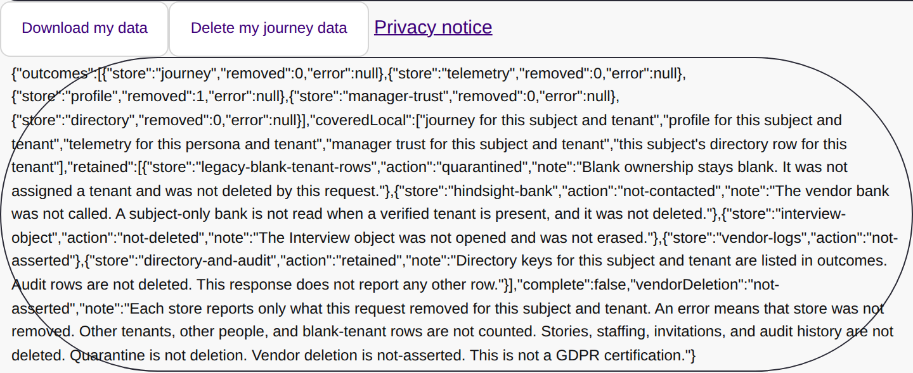
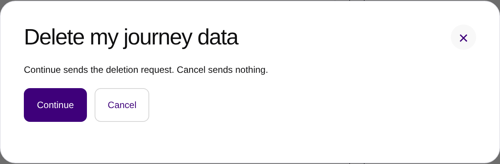
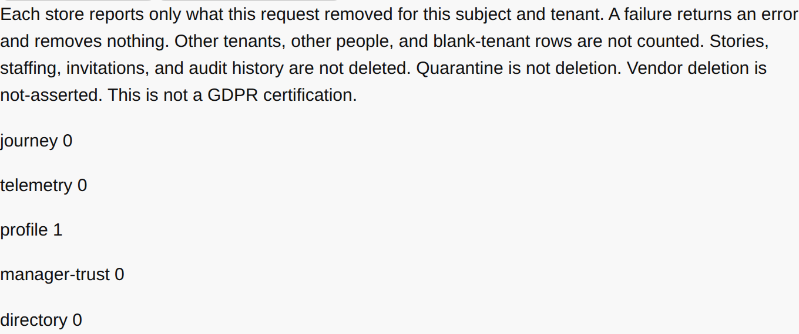
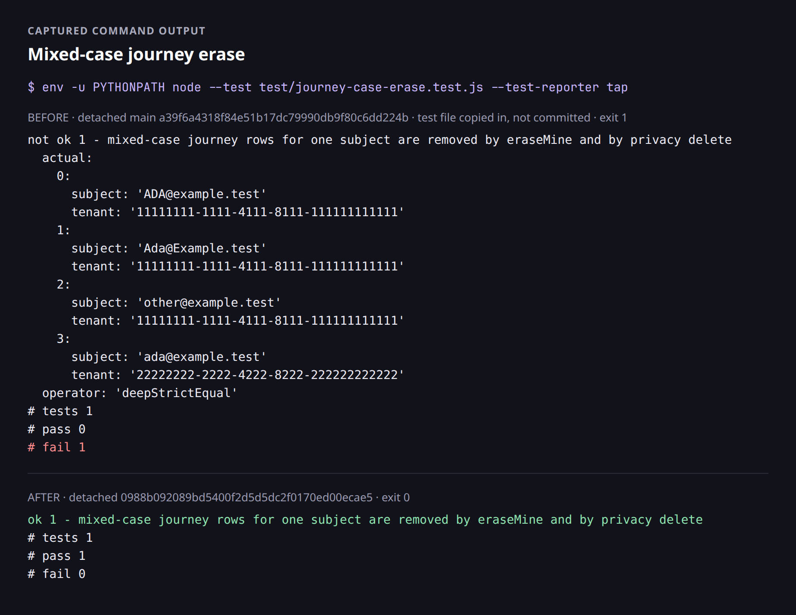

A person confirms a journey deletion before anything is removed, and a closed invitation stays closed.

## Why it matters

Journey deletion used to send on the first click and answer with a raw JSON blob. A failure in that blob could mean some stores were already gone. The same address written as Ada@ or ADA@ could remain after an erase of ada@. On a closed invitation, the person now gets a card that says nothing was changed, and a different failure is not turned into that card.

## What changed

- The delete button asks first. The dialog says “Continue sends the deletion request. Cancel sends nothing.” The button stays disabled while the dialog is open.
- A finished delete shows a receipt. The note says “A failure returns an error and removes nothing.” and lists what this request removed for this subject and tenant.
- Journey erase matches the subject without regard to letter case, inside the one deletion transaction. Another person, and the same person in another tenant, stay.
- A closed invitation is the code `INVITATION_CLOSED`. The Teams card title is “This invitation is closed.” and the text is “Nothing was changed.” Any other error is returned as that same error.

Before, on main `a39f6a43`. Delete posts immediately. The live JSON note says “An error means that store was not removed.”

After, on `0988b092`. The dialog, with the delete button disabled behind it.

The receipt after Continue. Profile removed 1. Journey, telemetry, manager-trust and directory removed 0 for this synthetic tenant.

The mixed-case erase test, copied onto main and run there, then run on `0988b092`. On main, `ADA@example.test` and `Ada@Example.test` are still present. On `0988b092` the test passes.

## Verified by

Page shots, this session. Both servers: `ATLAS_LOCAL_TENANT=11111111-1111-4111-8111-111111111111 node dev/local-edge.mjs`, ports 8791 (main) and 8792 (`0988b092`), then open `/?as=ada@example.test` and Journey → Delete my journey data. The committed page and the privacy handler are the ones at each SHA. Main’s local demo always sets the token subject to `local:` plus the email, so that page answers “A verified tenant is required.” The screenshot process used an uncommitted subject helper, the same one already on `0988b092`, so the synthetic tenant could reach the success note. The fixed “TEST DEPLOYMENT” chip was hidden, and the privacy block was capped at 720px, so the returned JSON could wrap. The words in the pictures are the live response.

Mixed-case, this session. `env -u PYTHONPATH node --test test/journey-case-erase.test.js --test-reporter tap` from `deploy/cloudflare-edge`. On main the test file was copied in and not committed: tests 1, pass 0, fail 1, exit 1. On `0988b092`: tests 1, pass 1, fail 0, exit 0.

Closed card, this session. `outreach.system` on `0988b092`, synthetic `ada@example.test`, with the invitation update throwing status 409 and code `INVITATION_CLOSED`. The returned card body is the title “This invitation is closed.” and the text “Nothing was changed.”

Gates recorded on the frozen head `0988b092` in `handoff/BUILD_STATUS.md`, for the code at parent `3426157` (the head commit adds that note). Python 3.12.3. Not re-run for this description.

- `python3 -m pytest tests/test_*.py -q`: 308 passed, 122 warnings, 22.55s
- `node --test tests/*.test.js`: 409 tests, 408 pass, 0 fail, 1 skip (`tests/geo.test.js`, `ATLAS_NE_SRC` unset)
- `env -u PYTHONPATH node --test test/*.test.js` in `deploy/cloudflare-edge`: 815 pass
- the same edge command with `--test-concurrency=16`: 815 pass
- eight-caller files, 50 runs at concurrency 16: 25 pass, 0 fail each run
- page pin `b81d08a5b57a9b75adb71dde74d59fe0e8f8b82098af8eb0e3d4efb0b2fbceea`, 923313 bytes, checked twice
- `make test-ui` three times: 805 PASS, 0 FAIL

{{CURSOR}}

{{DEVIN}}

{{SENTINEL}}
