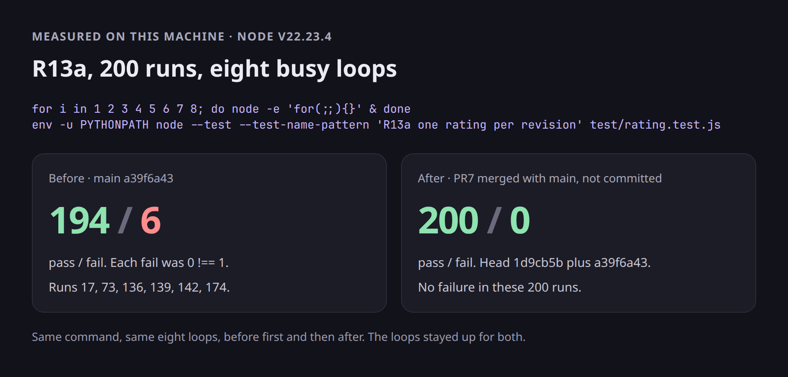

The rating check counts the request when it starts, so a busy machine no longer fails a healthy run.

## Why it matters

R13a waited 5 milliseconds and then required one rating request. On a busy machine that timer can run before the body hash finishes, so the check sees zero requests and fails. The product still sends one request for the revision. The flicker was the timer racing the hash.

## What changed

- The test holds the body hash, lets the 5 ms timer run, and requires zero requests then. The assertion is “a 5 ms timer is not the request.”
- It releases the hash and waits until the fetcher is entered, with a 2 second limit (`rating digest never started within 2000ms`), then requires one request.
- Two reviews of the same revision still share that one request.
- The rating product path is the same. This change is in the test.

## Verified by

This session, N=200, node v22.23.4. Eight `node -e 'for(;;){}'` processes stayed up for the whole comparison. The main tree ran first, then the PR7 tree. Command, from `deploy/cloudflare-edge`:

`env -u PYTHONPATH node --test --test-name-pattern 'R13a one rating per revision' test/rating.test.js`

- Detached main `a39f6a43`: 194 pass, 6 fail. Each failure was `0 !== 1`, on runs 17, 73, 136, 139, 142 and 174.
- Detached `1d9cb5b` with `git merge --no-commit --no-ff a39f6a43`. The only conflict was `handoff/BUILD_STATUS.md`. It was left unresolved and nothing was committed. 200 pass, 0 fail.

Recorded on the frozen head `1d9cb5b` in `handoff/BUILD_STATUS.md`, and not re-run for this description: edge `env -u PYTHONPATH node --test test/*.test.js` 540/540; root `node --test tests/*.test.js` 384 pass, 1 skipped; pytest 264 passed; 240 runs of the fixed test under eight busy-loop processes, 0 failures.

{{CURSOR}}

{{DEVIN}}

{{SENTINEL}}
